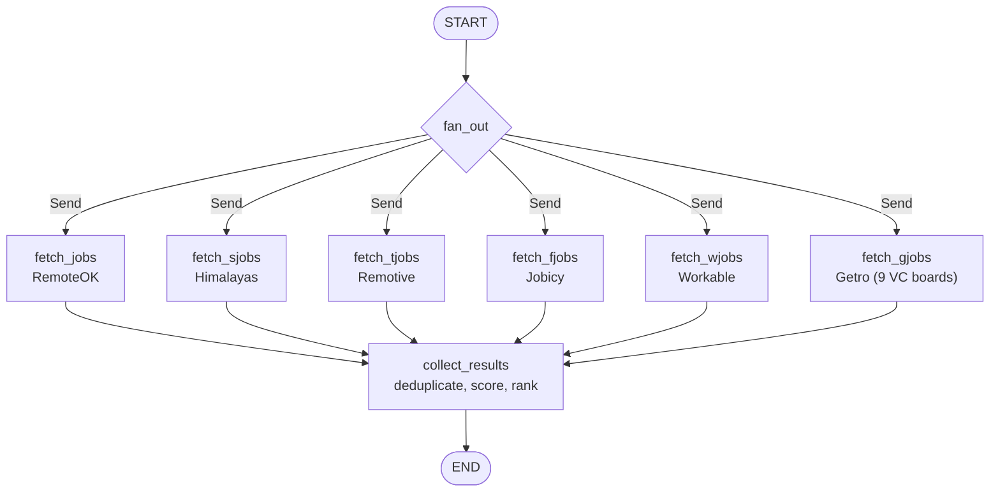

# Agent Graph & Scoring

`agent.py` defines the deterministic computational core shared by all three application interfaces: the FastAPI web backend ([Backend API](backend-api.md)), the Model Context Protocol server ([System Overview](overview.md#mcp-server)), and the LiveKit voice assistant. It is implemented as a LangGraph `StateGraph` that fans out across six remote job sources in parallel, normalizes and deduplicates listings, scores candidates using title-weighted keyword matching and frequency heuristics, and aggregates up to 12 top-ranked listings.

No Large Language Model (LLM) is used in the search, scoring, or ranking pipeline. The search pipeline is fully deterministic, zero-cost, and reproducible. LLMs are reserved strictly for external tasks: parsing spoken voice input, extracting structured keywords from uploaded CVs, and running offline evaluation judges.

## State Definition and Reducers

The graph operates over a central `State` TypedDict defined in `agent.py`:

```python
class State(TypedDict):
    fetched_jobs: Annotated[list[dict], add_or_reset]
    clean_jobs: list[dict]
    last_fetch_time: str
    current_job: dict
    user_input: str = ""
    country: str = ""
    memory: Annotated[list[str], add_or_reset]
```

### State Fields and the add_or_reset Reducer

The state fields carry both execution inputs and accumulated job collections:

- `user_input`: The user's raw search query string (e.g., `"python developer"`).
- `country`: The ISO country code or slug selected by the user (default `""` for worldwide/all locations).
- `fetched_jobs`: Raw listings gathered across all parallel fetcher nodes.
- `clean_jobs`: The final ranked, scored, deduplicated, and truncated listings produced by `collect_results`.
- `last_fetch_time`: ISO 8601 timestamp written when a query produces matching jobs.
- `current_job`: Holds a selected job dictionary during detail inspection.
- `memory`: Accumulated user exclusion filters (e.g., negative keywords like `"no senior"`, `"no php"`).

`fetched_jobs` and `memory` use the `add_or_reset` reducer:

```python
def add_or_reset(existing: list, new: list | None) -> list:
    if new is None:
        return []
    return existing + new
```

Because the six fetcher nodes execute concurrently, each returns a partial dictionary `{"fetched_jobs": [...]}`. LangGraph applies the reducer to merge each incoming list into `existing`. Once the collector finishes processing, `collect_results` returns `{"fetched_jobs": None}`, triggering the `if new is None` branch to reset the accumulated list to empty, preventing cross-turn memory leaks.

When executed via `run_agent()` in `helper.py`, the graph is called with `durability="exit"`. This instructs LangGraph to write a checkpoint to Postgres (or in-memory store) only upon run completion rather than after every individual node step, reducing checkpoint storage overhead from ~3.7MB to ~41KB per search.

## Graph Topology and Fan-Out Execution

The state graph uses a fan-out / fan-in architecture. A single conditional edge dispatches six parallel worker nodes using LangGraph's `Send` API, and all six worker nodes point directly to `collect_results`.


*LangGraph state transitions: parallel fan-out to six fetcher nodes via the Send API and convergence at collect_results.*

### Fan-Out Wiring

The graph is constructed and registered in `agent.py`:

```python
def fan_out(state: State):
    return [
        Send("fetch_jobs", state),
        Send("fetch_sjobs", state),
        Send("fetch_tjobs", state),
        Send("fetch_fjobs", state),
        Send("fetch_wjobs", state),
        Send("fetch_gjobs", state),
    ]

graph = StateGraph(State)
graph.add_node("fetch_jobs", fetch_jobs)
graph.add_node("fetch_sjobs", fetch_sjobs)
graph.add_node("fetch_tjobs", fetch_tjobs)
graph.add_node("fetch_fjobs", fetch_fjobs)
graph.add_node("fetch_wjobs", fetch_wjobs)
graph.add_node("fetch_gjobs", fetch_gjobs)
graph.add_node("collect_results", collect_results)

graph.add_conditional_edges(START, fan_out)
graph.add_edge("fetch_jobs", "collect_results")
graph.add_edge("fetch_sjobs", "collect_results")
graph.add_edge("fetch_tjobs", "collect_results")
graph.add_edge("fetch_fjobs", "collect_results")
graph.add_edge("fetch_wjobs", "collect_results")
graph.add_edge("fetch_gjobs", "collect_results")
graph.add_edge("collect_results", END)
```

Each `Send` object receives a copy of the root `State`. The graph runner executes all six fetchers concurrently on thread workers. Network failures or timeouts in individual fetchers are caught locally and return `{"fetched_jobs": []}`, ensuring that failure in any one external API does not abort the graph run.

## Job Source Fetchers

The graph delegates fetching across six source-specific nodes tailored to different API semantics and caching behaviors:

### 1. fetch_jobs (RemoteOK)

RemoteOK exposes `https://remoteok.com/api`. Key characteristics:
- **Distinctive token queries**: Iterates over tags generated by `distinctive_tokens(state["user_input"])` (capped at `TAG_LIMIT = 3`). If no distinctive tokens exist, it makes an untagged request.
- **Short-circuiting**: Halts tag iteration as soon as a single tag yields `>= ENOUGH` (50) results.
- **Deduplication**: Merges responses into a `raw` dictionary keyed by URL or ID (`raw.setdefault(job.get("url") or job.get("id"), job)`).
- **Title verification**: RemoteOK listing tags often contain SEO filler (e.g., healthcare jobs tagged with `python` and `postgres`). To prevent false positives, `fetch_jobs` discards any listing whose title does not match at least one signal token via `title_hit(token, job_title(job))`.

### 2. fetch_sjobs (Himalayas)

Queries `https://himalayas.app/jobs/api/search?q={query}&worldwide=true&sort=recent`.
- Returns the list under `data.get("jobs", [])`.
- Returns `{"fetched_jobs": []}` on HTTP 429 (rate limit) or `RequestException`.

### 3. fetch_tjobs (Remotive)

Remotive is treated as an in-memory cached feed rather than an active search API:
- **Cache mechanism**: Remotive's edge cache does not vary on search query parameters; different queries return identical listings with Cloudflare cache hits. Consequently, `remotive_feed()` stores listings in a module-level dictionary `_REMOTIVE = {"at": 0.0, "jobs": []}` with a TTL of 6 hours (`REMOTIVE_TTL = 6 * 3600`).
- **Fail-safe refresh**: If a refresh request fails or encounters a non-200 status, the previous feed is retained instead of cleared.
- **Filtering**: `fetch_tjobs` filters the cached feed locally, keeping only listings where `title_hit(token, job_title(job))` matches at least one query `signal_token`.

### 4. fetch_fjobs (Jobicy)

Jobicy supports both keyword tags and geographic filtering:
- Uses `distinctive_tokens` and appends `geo={country}` when a country is selected.
- **400 retry logic**: An unrecognized country code causes Jobicy to return HTTP 400. On 400, the fetcher strips the `geo` parameter and retries the request without geographic constraints, delegating country filtering to the downstream `location_ok` check in `collect_results`.
- Halts iteration when a tag returns `>= ENOUGH` (50) results. If all tagged attempts yield zero listings, it falls back to an untagged request.

### 5. fetch_wjobs (Workable)

Workable represents the applicant tracking system used widely by European companies. It uses a specialized two-round crawl:
1. **Search Crawl (`workable_urls`)**: Requests `https://jobs.workable.com/search/{country}/remote-{token}-jobs` using path-based URLs (since `robots.txt` disallows query parameters on `/search`). The country segment is required; when empty, `worldwide` is substituted. The page HTML contains a schema.org `ItemList` in `<script type="application/ld+json">`. URLs are extracted and deduplicated by `workable_key(url)` (slug combining job title and company token). Only links whose slug title matches query signal tokens via `title_hit` are kept.
2. **Detail Extraction (`workable_job`)**: Crawls individual posting pages for surviving URLs up to `WORKABLE_DETAILS = 6`. Parses schema.org `JobPosting` LD+JSON to extract `title`, `hiringOrganization.name`, `applicantLocationRequirements.name`, `description`, `datePosted`, and apply URL.

### 6. fetch_gjobs (Getro VC Portfolio Boards)

Getro hosts job boards for venture capital funds, aggregating startup roles that rarely appear on standard job boards:
- **Fund Portfolio IDs**: Searches 9 VC funds configured in `GETRO_VCS = [1680, 53552, 617, 222, 4350, 1518, 7715, 178, 29066]` (Point Nine, Creandum, Earlybird, General Catalyst, Backed, Smartfin, Antler, firstminute, and Theory).
- **Internal ThreadPoolExecutor**: Queries all 9 VC boards concurrently using `ThreadPoolExecutor(max_workers=len(GETRO_VCS))`, preventing sequential network waits and keeping node latency close to the slowest fund board (~1.4 seconds).
- **Two-phase search (`vcsearch`)**: For each fund, posts to `https://api.getro.com/api/v2/collections/{VC}/search/jobs` with `work_mode: ["remote"]` and the canon-normalized query. If fewer than 10 jobs are returned, it falls back to querying each distinctive token tag.
- **Schema Mapping**: Normalizes Getro's JSON structure:
  - `organization.name` -> `job["company"]`
  - `locations` list -> `job["location"]` (joined with commas)
  - `created_at` -> `job["epoch"]`
  - `skills` list -> `job["description"]` (joined with commas, serving as description text)
- **Deduplication and Title Verification**: Merges results across all 9 funds into `raw` keyed by URL or ID (`raw.setdefault(job.get("url") or job.get("id"), job)`), and retains only listings satisfying `any(title_hit(token, job_title(job)) for token in signal)`.

*(Note: An additional node, `fetch_fijobs` for Arbeitnow, remains commented out in `agent.py` and is not wired into the graph).*

## Tokenization, Aliasing, and Equivalence

Query parsing and matching rely on four targeted helper functions designed to prevent synonym mismatches:

### canon and ALIASES

Different job boards write equivalent role and skill names differently (e.g., "ml engineer" vs. "machine learning engineer"). The `ALIASES` dictionary standardizes terms before any matching occurs:

```python
ALIASES = {
    "large language models": "llm",
    "large language model": "llm",
    "natural language processing": "nlp",
    "artificial intelligence": "ai",
    "machine learning": "ml",
    "full-stack": "fullstack",
    "full stack": "fullstack",
    "back-end": "backend",
    "back end": "backend",
    "front-end": "frontend",
    "front end": "frontend",
    "postgresql": "postgres",
    "javascript": "js",
    "developer": "engineer",
}
```

The function `canon(text: str) -> str` converts input text to lowercase and replaces each alias phrase with its canonical short form. It is applied when parsing query tokens (`signal_tokens`), extracting job titles (`job_title`), normalizing descriptions in `score_job`, and querying Getro in `fetch_gjobs`.

### 'Engineer' and 'Developer' Equivalence

A critical mapping in `ALIASES` is `"developer": "engineer"`. Job boards treat these terms as interchangeable, but raw string matching previously split searches into disjoint sets. Under this alias:
- When a user searches for `"python developer"`, `canon(query)` transforms the query to `"python engineer"`.
- When a job listing has the title `"Python Developer"`, `job_title(job)` runs `canon()` and produces `"python engineer"`.
- In `collect_results`, the admission check tests `wants_engineer = title_hit("engineer", canon(query))`. Because `"developer"` canonicalizes to `"engineer"`, both developer and engineer searches trigger the requirement that the job title must also contain `"engineer"`. This guarantees identical search coverage across both titles while filtering out unrelated roles (such as "Engineering Manager" or non-technical roles).

### signal_tokens and distinctive_tokens

- **`signal_tokens(query: str) -> list[str]`**: Extracts words from `canon(query)` that carry semantic meaning, removing words in `GENERIC`:
  ```python
  GENERIC = frozenset({
      "engineering", "software", "developer", "dev", "engineer",
      "remote", "job", "jobs", "work", "role", "position",
      "specialist", "expert", "manager"
  })
  ```
  If all words in the query are generic (e.g., `"developer job"`), `signal_tokens` falls back to the full token list so generic queries still return results.
- **`distinctive_tokens(query: str) -> list[str]`**: Selects up to `TAG_LIMIT = 3` non-generic tokens in appearance order, deduplicated. Crucially, it tokenizes the raw query `query.lower()` without alias substitution, preserving literal terms (e.g., `react`, `python`) required by tag-based external APIs (RemoteOK, Jobicy, and Getro fallbacks).

### title_hit Matching Heuristic

```python
def title_hit(token: str, title: str) -> bool:
    return re.search(rf'\b{re.escape(token)}(?:js|s|\d+)?\b', title) is not None
```

`title_hit` enforces word-boundary matching with permitted suffixes:
- Suffixes allowed: Plurals (`s`), version numbers (`\d+`), and technology suffixes (`js`). For example, `"python"` matches `"python3"`, `"react"` matches `"reactjs"`, and `"agent"` matches `"agents"`.
- Prefixes prohibited: Word-boundary `\b` prevents prefix substrings from matching unrelated words. For example, `"rust"` cannot match `"anti-trust"`, and `"java"` cannot match `"javascript"`.

## Candidate Scoring Algorithm

The `score_job` function assigns a numerical relevance score to a job against the user query:

```python
def score_job(job: dict, query: str) -> float:
    title = job_title(job)
    description = canon(job.get("description") or job.get("jobDescription", "")
                   or job.get("excerpt", "") or job.get("jobExcerpt", "") or "")
    signal = signal_tokens(query)
    words = re.findall(r'\w+', canon(query).lower())
    gen = [w for w in words if w in GENERIC]
    if len(words) == len(gen):
        gen_hits = 0
    else:
        gen_hits = sum(1 for g in gen if title_hit(g, title))
    desc_words = re.findall(r'\w+', description)
    freq = sum(desc_words.count(s) for s in signal)
    bonus = freq / 8
    title_hits = sum(1 for s in signal if title_hit(s, title))
    desc_hits = sum(1 for s in signal if s in desc_words)
    hits = min(desc_hits + gen_hits + bonus, 9) + title_hits * TITLE_WEIGHT
    return hits
```

### Scoring Components and Invariants

Scoring synthesizes four signals:
1. **Title Matches (`title_hits * TITLE_WEIGHT`)**: Number of signal tokens matching `job_title(job)` via `title_hit`, multiplied by `TITLE_WEIGHT = 10`.
2. **Description Vocabulary Matches (`desc_hits`)**: Number of distinct signal tokens that appear at least once in the canonicalized description word list.
3. **Generic Word Title Bonus (`gen_hits`)**: Counts how many generic query words (e.g., `"developer"`, `"software"`) appear in the job title. If the user query consists entirely of generic words, `gen_hits` is forced to 0 to prevent artificial inflation.
4. **Description Frequency Bonus (`bonus = freq / 8`)**: Total count of all signal token occurrences in `desc_words` divided by 8, rewarding descriptions that discuss the target technology extensively.

### Strict Title-Match Admission Invariant

The description and generic components are clamped:

$$\text{description\_score} = \min(\text{desc\_hits} + \text{gen\_hits} + \text{bonus},\; 9)$$

$$\text{total\_score} = \text{description\_score} + (\text{title\_hits} \times 10)$$

Because the description contribution is strictly capped at **9**, and admission in `collect_results` requires `score >= TITLE_WEIGHT` (10), **a listing cannot qualify without at least one title match**. Description hits can only reorder and rank candidates that have already matched the query in their title; body text mentions cannot admit an irrelevant role.

## Deduplication and Result Collection

`collect_results` serves as the convergence node that aggregates, deduplicates, filters, ranks, and truncates listings:

```python
def collect_results(state: State):
    seen = set()
    unique_jobs = []
    query = state.get("user_input")
    country = state.get("country", "")
    for job in state["fetched_jobs"]:
        key = re.sub(r'[^a-z0-9]', '', f"{job_company(job).lower()}{job_title(job)}")
        if key not in seen and location_ok(job, country) and job_is_recent(job):
            seen.add(key)
            unique_jobs.append(job)
    scored = [(score_job(job, query), job) for job in unique_jobs]
    wants_engineer = title_hit("engineer", canon(query))
    matched = [pair for pair in scored
               if pair[0] >= TITLE_WEIGHT
               and (not wants_engineer or title_hit("engineer", job_title(pair[1])))]
    matched.sort(key=lambda pair: pair[0], reverse=True)
    matched = matched[:MAX_RESULTS]
    correct_jobs = []
    for _, job in matched:
        description = job.get("jobDescription", "") or job.get("description", "")
        job["description"] = strip_html(description)[:2000]
        correct_jobs.append(job)
    if len(correct_jobs) == 0:
        return {"clean_jobs": correct_jobs, "fetched_jobs": None}
    else:
        return {
            "clean_jobs": correct_jobs,
            "fetched_jobs": None,
            "last_fetch_time": datetime.now().isoformat()
        }
```

### Deduplication Heuristics

Job boards frequently cross-post identical roles across different cities or platforms, each generating a distinct application URL. Deduplicating on application URL would allow five or six identical listings for the same opening to crowd out valid results.

Instead, `collect_results` deduplicates using a **company + title sanitization hash**:
```python
key = re.sub(r'[^a-z0-9]', '', f"{job_company(job).lower()}{job_title(job)}")
```
- `job_company(job)` extracts employer names across divergent source keys (`company`, `companyName`, `company_name`).
- `job_title(job)` extracts the role title and passes it through `canon()`.
- `re.sub(r'[^a-z0-9]', '', ...)` strips all whitespace, punctuation, and casing differences.

Deduplication occurs **before** scoring and truncation to ensure duplicates do not consume any of the top 12 slots.

### Location Filtering (`location_ok`)

Filters listings against the selected `country`:
- If `country` is empty, all jobs pass (`True`).
- If the listing's location text (`job_location(job)`) is blank, it passes (most remote boards leave location blank when open worldwide).
- Matches against the requested country name, mapped broader regions in `REGIONS` (e.g., Greece/Cyprus/Germany map to Europe, EMEA, EU; US maps to Americas, USA; Australia maps to APAC, Oceania), or global keywords in `GLOBAL_WORDS` (`"worldwide"`, `"anywhere"`, `"global"`, `"world wide"`).
- The token `"remote"` alone is deliberately excluded from `GLOBAL_WORDS`; a listing stating `"Remote, US only"` specifies how work is performed, not candidate eligibility.

### Recent Date Filtering (`job_is_recent`)

Stale listings degrade search quality, especially on platforms like Workable that keep filled vacancies indexed for months:
- Cutoff window: `MAX_AGE_DAYS = 120` days.
- Extracts date fields from `date`, `pubDate`, `publication_date`, `datePosted`, or `epoch`.
- Accepts integer/float epoch timestamps (`fromtimestamp(..., tz=timezone.utc)`) or ISO 8601 datestamps (`fromisoformat(...)`).
- Unparseable or missing dates return `True`: absence of a date field is treated as unknown age rather than staleness.

### wants_engineer Admission Gate

Beyond meeting `score >= TITLE_WEIGHT` (10), listings must satisfy the role check:
```python
wants_engineer = title_hit("engineer", canon(query))
matched = [pair for pair in scored
           if pair[0] >= TITLE_WEIGHT
           and (not wants_engineer or title_hit("engineer", job_title(pair[1])))]
```
When `wants_engineer` is true (due to the query containing `"engineer"` or `"developer"`), the listing's title must also match `"engineer"` (which includes canon-normalized `"developer"`). This blocks listings like "Director of Product" or "Engineering Manager" that score high on keyword hits but represent management rather than engineering roles.

### Description Truncation and State Cleanup

- **Truncation**: For each surviving job in `matched[:MAX_RESULTS]`, HTML tags and entities are stripped via `strip_html`, and the description is truncated to 2000 characters.
- **Cache Timestamp**: `last_fetch_time` is updated with `datetime.now().isoformat()` only when `correct_jobs` is non-empty. An empty search result does not advance the timestamp, ensuring retries re-trigger graph execution.
- **Memory Cleanup**: `fetched_jobs` is returned as `None`, clearing accumulated raw jobs via `add_or_reset`.

## Downstream Pipeline (Interface Layer)

After the LangGraph graph finishes, the calling interface layer runs two additional processing stages:

### filter_jobs (Thread Memory Exclusion)

Defined in `agent.py` and called before presenting results:
- Flattens user exclusion keywords stored in `state["memory"]`.
- Categorizes keywords: words present in `SENIORITY` are checked against **job title tokens only**; all other keywords (e.g., `"php"`, `"react"`) are checked across **title, description, and location**.
- `SENIORITY` terms include: `senior`, `sr`, `junior`, `júnior`, `jr`, `lead`, `principal`, `staff`, `mid`, `entry`, `pleno`, `sênior`, `estágio`, `head`, `director`, `vp`, `chief`. Matching seniority against titles only prevents dropping mid-level roles whose job description mentions "reporting to a senior engineer".
- Removes listings lacking an `apply_url` or having an empty / `"Unknown"` position.

### normalize_jobs and format_jobs_markdown

- **`normalize_jobs`**: Canonicalizes field names to `company`, `position`, `location`, `description`, `salary`, and `apply_url`. Repairs Latin-1/UTF-8 mojibake with `fix_mojibake`, removes placeholder salaries (e.g. `"$0 - $0"` becomes `"Salary not listed"`), and performs a final deduplication pass using a sanitized `company + position` hash.
- **`format_jobs_markdown`** (`helper.py`): Formats clean jobs into Markdown cards for display, shortening descriptions with `textwrap.shorten(..., width=150)` and appending active filter tags and source attribution.

## Constants and Configuration Reference

| Constant | Value | Purpose |
|---|---|---|
| `TITLE_WEIGHT` | `10` | Score weight per title match; minimum score threshold for admission |
| `MAX_RESULTS` | `12` | Maximum number of top-ranked jobs returned by `collect_results` |
| `MAX_AGE_DAYS` | `120` | Cutoff age in days for `job_is_recent` filtering |
| `TAG_LIMIT` | `3` | Maximum number of distinctive tokens extracted from query for tag-based queries |
| `ENOUGH` | `50` | Result count threshold to stop querying subsequent tag variants |
| `REMOTIVE_TTL` | `21600` (6h) | Cache lifetime for in-memory Remotive feed in seconds |
| `WORKABLE_DETAILS` | `6` | Maximum number of individual Workable posting pages fetched per search |
| `GETRO_VCS` | 9 fund IDs | List of Getro fund collection IDs searched by `fetch_gjobs` |

## Related Pages

- [System Overview](overview.md) — Architectural overview, three caller interfaces, Redis caching, and LangGraph checkpointing.
- [Backend API](backend-api.md) — FastAPI endpoint lifecycle, `/search`, `/feedback`, and `/reset` request handling.
- [Domain Concepts](../domains.md) — Detail on thread memory filters, mojibake repair, and location mapping.
- [Integrations](../integrations.md) — Third-party job boards, ATS scrapers, and external API specifications.
