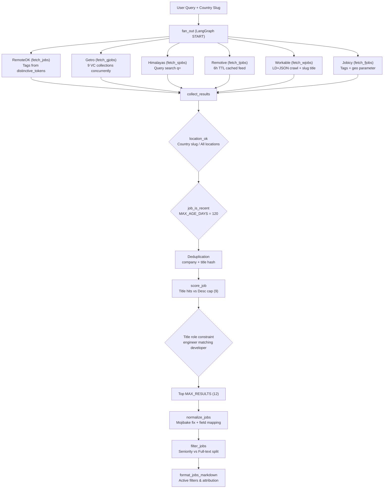

# Domain Concepts & Scoring Models

The search agent aggregates, canonicalizes, deduplicates, scores, and filters remote engineering job listings across heterogeneous sources. Post-processing combines deterministic whole-word heuristics, query alias canonicalization, geographic constraints, thread memory exclusions, and structured LLM evaluation pipelines.


*Figure: Remote job listing lifecycle from concurrent multi-source aggregation through relevance scoring and thread memory exclusion.*

---

## Core Domain Models & Data Schemas

The system coordinates search, state persistence, and evaluation across several structured domain models:

### 1. LangGraph State (`State`)
Defined in `agent.py`, `State` is the TypedDict schema passed through graph nodes:

```python
class State(TypedDict):
    fetched_jobs: Annotated[list[dict], add_or_reset]
    clean_jobs: list[dict]
    last_fetch_time: str
    current_job: dict
    user_input: str = ""
    country: str = ""
    memory: Annotated[list[str], add_or_reset]
```

- **`user_input` (`str`)**: The search query string submitted by the user or derived from CV keywords.
- **`country` (`str`)**: The geographic constraint, represented as a country slug (such as `"united-states"`, `"germany"`, `"greece"`) or `""` for "All locations".
- **`fetched_jobs` (`Annotated[list[dict], add_or_reset]` treated with `add_or_reset`)**: Raw listings collected concurrently across the six fetcher nodes during graph fan-out. In `collect_results`, once listings are filtered, deduplicated, and scored into `clean_jobs`, `fetched_jobs` is reset to `None` so that `add_or_reset` clears the raw list to `[]`. This prevents unneeded payloads from bloating PostgreSQL checkpoints.
- **`clean_jobs` (`list[dict]`):** The top admitted listings (capped at `MAX_RESULTS = 12`) with descriptions truncated to 2,000 characters for graph state persistence.
- **`memory` (`Annotated[list[str], add_or_reset]` treated with `add_or_reset`)**: User feedback exclusion terms accumulated across conversation turns. Each turn appends comma-separated exclusion strings (e.g., `["junior, intern"]`). Passing `None` resets the list to `[]`.
- **`last_fetch_time` (`str`)**: An ISO-formatted timestamp (`datetime.now().isoformat()`) recorded when a fetch yields results.
- **`current_job` (`dict`)**: A placeholder slot for single-job inspection.

```python
def add_or_reset(existing: list, new: list | None) -> list:
    if new is None:
        return []
    return existing + new
```

### 2. Job Representations (Raw vs. Normalized)
Heterogeneous remote job boards return wildly different JSON structures:
- RemoteOK, Jobicy, and Himalayas provide flat or semi-nested JSON records.
- Remotive provides an API feed of remote jobs.
- Getro returns startup portfolio company listings with a `skills` array rather than long descriptions.
- Workable returns schema.org `JobPosting` and `ItemList` nodes embedded in `<script type="application/ld+json">` tags.

`normalize_jobs` maps these heterogeneous raw source fields into a canonical job dictionary:

| Canonical Field | Source Fields Resolved | Processing & Invariants |
|---|---|---|
| `company` | `company`, `companyName`, `company_name`, `organization.name` | Mojibake fixed via `fix_mojibake`, whitespace collapsed |
| `position` | `title`, `position`, `jobTitle` | Mojibake fixed via `fix_mojibake`, whitespace collapsed |
| `location` | `location`, `jobGeo`, `candidate_required_location`, `locationRestrictions`, `locations` | Comma-separated string, mojibake fixed |
| `description` | `description`, `jobDescription`, `excerpt`, `jobExcerpt`, `skills` | HTML stripped (`strip_html`), HTML entities unescaped, mojibake fixed |
| `salary` | `salary`, `salary_min` & `salary_max`, `minSalary` & `maxSalary` | Formatted range or raw string; defaults to `"Salary not listed"` if empty or zeroed |
| `apply_url` | `apply_url`, `url`, `applicationLink` | Direct application link |

- **Mojibake Repair (`fix_mojibake`)**: Resolves double-encoded UTF-8 strings common in web-scraped feeds by attempting `text.encode("latin-1").decode("utf-8")`. On failure, it returns the original string unmodified.
- **Deduplication Key**: Job listings often duplicate across cities (e.g., six postings for the same employer and position). A composite alphanumeric hash `re.sub(r'[^a-z0-9]', '', f"{company.lower()}{position.lower()}")` deduplicates postings before scoring so identical roles do not occupy multiple slots in the top twelve results.

### 3. Resume Keyword Schema (`CVKeywords`)
Defined in `helper.py`, `CVKeywords` guides structured keyword extraction by Gemini 3.5 Flash-Lite during PDF resume uploads:

```python
class CVKeywords(BaseModel):
    keywords: list[str] = Field(
        description=(
            "Search keywords for this candidate's job hunt, most important first. "
            "Start with the role title (e.g. 'backend developer', 'data analyst', "
            "'graphic designer', 'accountant'), then the core skills or tools "
            "(e.g. 'python', 'figma', 'excel'). "
            "One or two words each, lowercase. No filler words like 'and', 'with', "
            "'skilled', 'experience', 'years'."
        )
    )
```

During asynchronous resume ingestion (`tasks.py`), Gemini extracts up to 10 prioritized keywords, which are joined into a search query string (`" ".join(response.keywords)`) executed against the standard graph pipeline.

---

## Job Source Aggregation

The agent aggregates remote listings from **six public and aggregator sources**, fanning out concurrently from `START` in the LangGraph state machine via `fan_out` and converging on `collect_results`:

1. **RemoteOK (`fetch_jobs`)** — Tag-based querying. The query's `distinctive_tokens` are tried sequentially as `?tags=`, halting as soon as a tag returns `ENOUGH` (50) listings. Listings are subsequently verified against the job title using `title_hit` with `signal_tokens` to eliminate irrelevant SEO tags.
2. **Getro (`fetch_gjobs`)** — Concurrent portfolio job searches across nine venture capital collections (`GETRO_VCS = [1680, 53552, 617, 222, 4350, 1518, 7715, 178, 29066]`) using a `ThreadPoolExecutor`. Each VC is queried with `{"filters": {"work_mode": ["remote"]}}`. If a VC board returns fewer than 10 listings, `vcsearch` issues supplementary requests using `distinctive_tokens`.
3. **Himalayas (`fetch_sjobs`)** — Full query search (`q=`), filtered worldwide and sorted by recent postings. HTTP 429 rate limits abort cleanly by returning an empty list rather than failing the graph run.
4. **Remotive (`fetch_tjobs` / `remotive_feed`)** — Cached feed rather than a dynamic search. Remotive's edge cache does not vary on search query parameters, returning a fixed listing set. `remotive_feed()` maintains an in-memory cache with a 6-hour TTL (`REMOTIVE_TTL = 6 * 3600`). Failed refreshes retain the previous cache payload. Listings are filtered locally in Python via `title_hit` using `signal_tokens`.
5. **Workable (`fetch_wjobs`)** — Two-stage structured LD+JSON extraction. First, `workable_urls` fetches `/search/{where}/remote-{token}-jobs` and extracts posting URLs from `<script type="application/ld+json">` `ItemList` nodes. The listing title is parsed directly from the URL slug (`workable_title`) *before* opening the job page, avoiding unnecessary network calls for non-matching roles. Second, `workable_job` opens surviving links (capped at `WORKABLE_DETAILS = 6`) to extract the `JobPosting` payload.
6. **Jobicy (`fetch_fjobs`)** — Tag-based querying with country geolocation (`tag=` and `geo=`). If Jobicy returns HTTP 400 (indicating an unrecognized country parameter), the request is retried without `geo`, deferring geographic enforcement to `location_ok`. If no listings return, it falls back to the untagged feed.

*Note on historical sources*: Arbeitnow was evaluated and removed (commit `b3738bc`) due to unreliable remote categorization that degraded evaluation pass rates.

---

## Getro VC Collections & Skills-as-Descriptions

Getro endpoints (`https://api.getro.com/api/v2/collections/{VC}/search/jobs`) return structured company and job metadata for startup portfolios, but omit long-form job descriptions. `vcsearch` adapts the Getro payload into the canonical job schema:

- **Company**: Extracted from `organization.name`.
- **Location**: Formatted from the `locations` array as a comma-separated string.
- **Timestamp**: Stored in `epoch` from `created_at`.
- **Skills-as-descriptions**: Getro provides a `skills` array (e.g., `["Python", "FastAPI", "Docker"]`). `vcsearch` joins these into `job["description"] = ", ".join(desc)`.

Populating `description` with comma-separated skills enables downstream subsystems to function uniformly without specialized Getro branches:
- `score_job` counts skill matches in the description frequency bonus (`freq / 8`).
- `filter_jobs` matches general exclusion keywords (technologies and frameworks) against Getro listings during thread memory filtering.

---

## Country Slug Filtering and "All Locations" Fallback

Geographic filtering operates through country slugs (such as `united-states`, `germany`, or `greece`) or an empty string (`""`):

### Source-Level Handling & Geo-Tags
- **Workable**: Embeds the country slug directly into the path: `https://jobs.workable.com/search/{where}/remote-{token}-jobs`. When country is empty, `where` defaults to `worldwide`. If an explicit country slug returns zero URLs, `workable_urls` retries with `worldwide`.
- **Jobicy Fallback**: Appends `geo={country}` to the query string. When Jobicy encounters an unrecognized country name, it answers with HTTP 400 rather than an empty list. `fetch_fjobs` catches `response.status_code == 400 and country`, strips the `geo` parameter, and requests the endpoint again without geography, deferring filtering to `location_ok`. If no jobs are returned across the supplied tags, it falls back to the untagged feed (`https://jobicy.com/api/v2/remote-jobs`).
- **RemoteOK, Himalayas, Remotive, Getro**: Query remote listings globally and rely on downstream filtering.

### Post-Filtering in `collect_results` via `location_ok`
In `collect_results`, every candidate job must pass `location_ok(job, country)`:
- **Empty Country ("All locations")**: Returns `True` unconditionally, bypassing geographic filtering.
- **Unspecified Location**: If a job listing has an empty or blank location string, `location_ok` returns `True`. Across remote job boards, absence of location indicates worldwide eligibility.
- **Country Name**: Matches `country.replace("-", " ")` against the job's location string using whole-word `title_hit`.
- **Regional Grouping**: Consults the `REGIONS` mapping. For example, `greece` matches `europe`, `emea`, or `eu`; `united-states` matches `north america`, `americas`, `usa`, or `us`; `australia` matches `apac` or `oceania`.
- **Global Designations**: Matches any token in `GLOBAL_WORDS` (`worldwide`, `anywhere`, `global`, `world wide`).
- **Remote Alone Is Not Sufficient**: A listing stating solely `"Remote"` does **not** satisfy a specific country search. "Remote" specifies work modality, not candidate residency or hiring eligibility.

### Interface Fallback Display
In `helper.py`, `active_filters_line` formats the active search location for the markdown footer:
- If `country` is non-empty: `"Showing: {country.replace('-', ' ').title()}"` (e.g., `Showing: United States`).
- If `country` is empty: `"Showing: All locations"` (renamed from "Worldwide").

---

## Query Canonicalization & Title Role Constraints

### Synonym Canonicalization (`canon`)
`canon()` applies the `ALIASES` map so that varying industry terminology maps to unified tokens before matching:

| Raw Phrase | Canonical Form |
|---|---|
| `large language models`, `large language model` | `llm` |
| `natural language processing` | `nlp` |
| `artificial intelligence` | `ai` |
| `machine learning` | `ml` |
| `full-stack`, `full stack` | `fullstack` |
| `back-end`, `back end` | `backend` |
| `front-end`, `front end` | `frontend` |
| `postgresql` | `postgres` |
| `javascript` | `js` |
| `developer` | `engineer` |

`canon()` is applied to queries in `signal_tokens` and `score_job`, and to listing titles in `job_title(job)`. Distinctive token extraction (`distinctive_tokens`), however, operates on the raw lowercased query without canonicalization because external tag APIs expect standard spelled-out terms.

### Title Role Constraints ('engineer' matching 'developer')
The mapping `"developer": "engineer"` establishes bidirectional alignment for technical roles. In `collect_results`:

```python
wants_engineer = title_hit("engineer", canon(query))
matched = [
    pair for pair in scored
    if pair[0] >= TITLE_WEIGHT and (not wants_engineer or title_hit("engineer", job_title(pair[1])))
]
```

When a user searches for either `"developer"` or `"engineer"`, `canon(query)` produces `"engineer"`, activating `wants_engineer = True`. `collect_results` then requires a positive `title_hit("engineer", job_title(job))` on the candidate job. Because `job_title(job)` also passes the posting title through `canon()`, a listing titled "Python Developer" canonicalizes to "python engineer" and matches. This constraint prevents general engineering or developer searches from admitting adjacent non-development roles (such as product managers or technical writers) that may contain query keywords only in their descriptions.

### Whole-Word Matching (`title_hit`)
`title_hit(token, title)` executes the regular expression:
```python
r'\b{token}(?:js|s|\d+)?\b'
```
This requires a whole-word match while permitting standard suffixes: plural `s`, trailing version numbers (`python` matches `python3`), and technology suffixes (`react` matches `reactjs`). Prefixes are disallowed, preventing false positives such as `rust` matching `anti-trust` or `java` matching `javascript`.

---

## Relevance Scoring & Admission

`score_job(job, query)` computes a composite score balancing title relevance, description context, and token frequencies:

$$\text{score} = (\text{title\_hits} \times \text{TITLE\_WEIGHT}) + \min(\text{desc\_hits} + \text{gen\_hits} + \text{bonus}, 9)$$

- **`TITLE_WEIGHT` = 10**: Each query signal token found in the job title via `title_hit` contributes 10 points.
- **Description Contribution**:
  - `desc_hits`: Number of distinct signal tokens appearing in the description text.
  - `bonus`: Token frequency bonus calculated as $\text{freq} / 8$, where `freq` is the total count of all signal token occurrences in the description.
  - `gen_hits`: Generic tokens from `GENERIC` (`engineering`, `software`, `developer`, `dev`, `engineer`, `remote`, `job`, `jobs`, `work`, `role`, `position`, `specialist`, `expert`, `manager`) that appear in the title add 1 tie-breaking point. If the query consists *entirely* of generic words, `gen_hits` is forced to 0.
  - **The 9-Point Description Cap**: The entire non-title term $(\text{desc\_hits} + \text{gen\_hits} + \text{bonus})$ is strictly capped at `9`.

### Admission Invariant
`collect_results` enforces a cutoff of `score >= TITLE_WEIGHT` (10). Because description and generic contributions cannot exceed 9, **at least one title hit is strictly required for admission**. Description matches can reorder listings that already earned admission via a title match, but cannot admit a listing on their own.

---

## Normalization & Mojibake Repair

`normalize_jobs` maps heterogeneous source fields into a canonical representation:

- **Mojibake Repair (`fix_mojibake`)**: Attempts `text.encode("latin-1").decode("utf-8")` to fix double-encoded UTF-8 strings common in web-scraped feeds, falling back silently on failure.
- **Deduplication**: Deduplicated on `company + position` hash (`re.sub(r'[^a-z0-9]', '', f"{company.lower()}{position.lower()}")`). Duplicate job postings for the same role across multiple cities share the same hash and are dropped before scoring.
- **Description Lengths**: `collect_results` truncates raw descriptions to 2,000 characters for graph state. In the presentation layer, `clean_description` / `format_jobs_markdown` uses `textwrap.shorten(..., width=150, placeholder="...")` for concise markdown rendering.

---

## Age Filtering

`job_is_recent(job)` discards postings older than `MAX_AGE_DAYS = 120`. It parses ISO 8601 strings or epoch integers from `date`, `pubDate`, `publication_date`, `datePosted`, or `epoch`. If a listing contains no date or fails parsing, it is retained: **absence of a date is not age**.

---

## User Feedback Exclusion Semantics & Memory Mechanics

Thread memory allows users to exclude unwanted job types, seniority levels, technologies, or companies across a conversation session. Exclusions are accumulated as comma-separated strings in LangGraph state and reduced via `add_or_reset` (cleared when passed `None`).

### Avoiding False Exclusions
In `/feedback`, user feedback is converted to exclusion keywords with clear prompt boundaries:
```
Extract the job keywords to avoid from this user feedback.
Return only a comma-separated list of keywords, nothing else.
IMPORTANT: Only extract what to AVOID, not what the user wants to find.
Do not include terms like "AI engineer", "python developer" etc.
```
This protects against erroneously transforming positive user criteria into negative exclusions.

### The Seniority vs. Full-Text Split
`filter_jobs(jobs, memory, title_only=SENIORITY)` applies hard exclusions. Each memory entry is split into keywords on commas. Each keyword is split into constituent words:

```python
target = title_words if any(w in title_only for w in keyw) else full_words
if any(w in target for w in keyw):
    blocked = True
```

- **Seniority Keywords** (`SENIORITY = frozenset({"senior", "sr", "junior", "júnior", "jr", "lead", "principal", "staff", "mid", "entry", "pleno", "sênior", "estágio", "head", "director", "vp", "chief"})`):
  If any token in the exclusion keyword belongs to `SENIORITY`, the keyword is matched **strictly against the job title tokens** (`title_words`). This prevents phrases like "collaborate with senior engineers" or "reports to engineering director" in job descriptions from accidentally excluding junior or mid-level postings.
- **Full-Text Keywords**:
  All other exclusions (technologies like `react`, locations like `usa`, or company names) are matched against the combined text: `title + description + location` (`full_words`).
- **Data Hygiene Exclusions**:
  `filter_jobs` also drops listings lacking an `apply_url` or having empty or `"Unknown"` titles.

---

## Resume-Derived Search Intent (/upload)

The `/upload` flow processes PDF resumes asynchronously:
1. `pdfread` reads the first five pages using `pdfplumber`.
2. `/upload` enforces a 5 MB file size limit and dispatches processing to Celery (`filework.delay(text, thread_id, country)`), returning `{"job_id": job.id}` so FastAPI does not block the event loop.
3. Callers poll `/jobs/{job_id}` for completion.
4. Inside `filework` (`tasks.py`), Gemini 3.5 Flash-Lite (`helper.llmchain(for_upload=True)`) extracts candidate keywords using structured Pydantic schema `CVKeywords` (ordered role titles followed by primary skills, maximum 10 words).
5. The extracted keywords are joined into a search query string and executed through the standard `graph`, `normalize_jobs`, and `filter_jobs` pipeline.

---

## Evaluation Metrics & Correctness Scoring Models

System quality is validated through two distinct evaluation frameworks:

### 1. LangSmith Evaluation Harness (`eval_runner.py`)
`eval_runner.py` executes 24 live-query evaluations against the `/askeval` endpoint using the `EVALS` API key (`x-api-key`). Because live board contents fluctuate hourly, the aggregate baseline (~0.90) represents an expected operating range rather than a static regression bar.

Both structured LLM evaluators and the helper chain utilize **Gemini 3.5 Flash-Lite** (`google_genai:gemini-3.5-flash-lite`):

| Evaluator | Model / Engine | Target Schema / Key | Scoring Mechanism |
|---|---|---|---|
| `gemini_full_correctness` | Gemini 3.5 Flash-Lite | `Output(reason, relevant, total)` | Grades the full generated markdown string against reference criteria. Computes $\text{relevant} / \text{total}$. |
| `gemini_listing_correctness` | Gemini 3.5 Flash-Lite | `JobOutput(reason, relevant: bool)` under key `gemini35lite_listing_correctness` | Evaluates each listing individually via `askgemini`. Computes $\text{relevant} / \text{len(results)}$; returns 0 if results are empty unless `empty_ok` is true. |
| `jev_correctness` | OpenRouter `typesafe/jev-1.13` | Key `jev_correctness` | Evaluates each listing individually; counts as relevant if probability $\ge 0.5$. |
| `laya_correctness` | Local `laya serve` (`/v1/systemone`, model `multilingual`) | Key `laya_ml_correctness` | Evaluates each listing individually; counts as relevant if probability $\ge 0.5$. |

- **Empty Result Short-Circuit**: If an evaluation case specifies `empty_ok: True` and the response contains zero listings, every evaluator immediately records a score of `1.0` without invoking LLM or decision APIs.
- **Grading Invariants**: Evaluators grade strictly on the listings present. An expected listing that is absent does not lower the score, and listings on which criteria are silent are treated as relevant.
- **Current LangSmith Experiment**:
  ```python
  client.evaluate(
      run_agent,
      data="job-search-eval",
      evaluators=[jev_correctness, gemini_listing_correctness],
      experiment_prefix="gemini35lite-jev-perjob"
  )
  ```
  `gemini_full_correctness` and `laya_correctness` remain fully implemented and runnable, but the active experiment pipeline runs `jev_correctness` and `gemini_listing_correctness`.

### 2. Harbor Evaluation Harness
The Harbor evaluation (`filter-exclusion-senior`) verifies deterministic behavior without network calls, databases, or LLMs. It executes `mcp_server.search_remote_jobs` against five frozen source fixture datasets (RemoteOK, Himalayas, Remotive, Jobicy, Workable) and asserts strict set equality against `expected.json` (6 kept listings / 6 dropped listings).

---

## Related Documentation & Source References

### Related Pages
- [Agent Graph](architecture/agent-graph.md) — LangGraph state nodes, fan-out execution, and PostgreSQL checkpoint persistence.
- [Harbor Evaluation](evals/harbor-eval.md) — Harbor evaluation test execution, test fixtures, and expected outputs.
- [LangSmith Evaluation](evals/langsmith-eval.md) — LangSmith benchmarks, LLM correctness grading, and dataset runner.
- [Integrations](integrations.md) — External HTTP APIs, headers, rate limit handling, and ATS endpoints.
- [Testing](testing.md) — Harbor evaluation test execution, test fixtures, and LangSmith benchmarks.
- [Workflows](workflows.md) — Async resume upload pipeline, Celery worker processing, and feedback loops.

### Primary Source Files
- `agent.py` — Multi-source fetchers, `collect_results`, scoring heuristics (`score_job`), canonicalization (`canon`), and memory filtering (`filter_jobs`).
- `helper.py` — Gemini 3.5 Flash-Lite chain setup (`llmchain`), CV keyword extraction schema (`CVKeywords`), and markdown formatting (`format_jobs_markdown`).
- `eval_runner.py` — LangSmith test harness, Gemini 3.5 Flash-Lite structured grading (`gemini_full_correctness`, `gemini_listing_correctness`), and Jev/Laya evaluators.
- `main.py` — FastAPI routing, async `/upload` endpoint, `/askeval`, and memory state updates.
- `tasks.py` — Celery background task `filework` for resume extraction and search orchestration.
