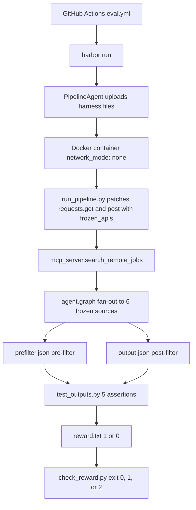

# Harbor Deterministic Evaluation

The Harbor deterministic evaluation is an offline regression test benchmark located in `evals/filter-exclusion-senior/` that verifies the agent's exclusion logic in `filter_jobs` ([Agent Graph](../architecture/agent-graph.md)). While the live [LangSmith Evaluation](langsmith-eval.md) monitors semantic relevance against external job boards that drift over time, Harbor freezes API responses into static fixtures and executes within a network-isolated environment to assert exact output sets.

Harbor ensures that any changes to the [Agent Graph](../architecture/agent-graph.md), candidate ranking rules in `collect_results`, or exclusion logic in `filter_jobs` preserve filtering correctness without incurring token costs or relying on external API availability. For broader testing strategies, see [Testing Overview](../testing.md) and [Domain Reference](../domains.md).

## What it Tests

The evaluation asserts the agent's ability to apply exclusion keywords to a pre-ranked result set: dropping listings whose **title** matches an excluded seniority term or whose **full text** matches any general exclusion keyword, while keeping every valid listing. Over-inclusion (an excluded job survives) and over-filtering (a valid job is dropped) both fail the test.

The standard evaluation query configured in `evals/filter-exclusion-senior/instruction.md` is `python developer` with exclusions `["senior", "game", "canonical"]`. These exclusions evaluate both branches of `filter_jobs` in `agent.py`:

| Term | What it drops | Matching rule & `filter_jobs` branch |
|---|---|---|
| `senior` | "Senior Software Engineer - Python/MongoDB" (Jobicy #149974), "Remote Senior Backend Engineer (Python)" (Workable) | **Title-only match** (`SENIORITY` frozenset). Scans `title_words` only; descriptions and locations are ignored. |
| `game` | Two Panda3D game developer listings (Himalayas) | **Full-text match** (general keyword). Scans `full_words` (`title + description + location`). |
| `canonical` | One Jobicy listing ("Python Engineer" #149543) and one Jobicy listing ("Python and Kubernetes Software Engineer" #149563) | **Full-text match** (general keyword). In the "Python Engineer" (149543) listing, the keyword appears only in the description body and company metadata, verifying full-text reach. |

### How Canonical Software Engineer Listings Match "python developer"

In `agent.py`, the candidate collection and ranking node `collect_results` determines which listings enter the top result set:

1. **Signal Extraction**: For the query `"python developer"`, `signal_tokens` strips `"developer"` because it belongs to `GENERIC`. The extracted signal token list is `["python"]`.
2. **Title Scoring**: In `score_job(job, query)`, any listing containing `"python"` in its title scores `title_hits * TITLE_WEIGHT` (where `TITLE_WEIGHT = 10`), easily passing the qualification threshold `score >= TITLE_WEIGHT`.
3. **Engineering Role Check**: The `wants_engineer` flag in `collect_results` is computed as `title_hit("engineer", canon(query))`. Because the query is `"python developer"` rather than `"python engineer"`, `wants_engineer` evaluates to `False`. The gating condition `(not wants_engineer or title_hit("engineer", job_title(pair[1])))` therefore passes for all qualified listings, allowing Canonical's "Software Engineer" postings to qualify despite having "engineer" rather than "developer" in their titles.
4. **Top 12 Selection**: The qualified candidates are sorted by score and capped at `MAX_RESULTS = 12`. Three Canonical listings from Jobicy score in the top 12:
   - "Senior Software Engineer - Python/MongoDB" (#149974)
   - "Python and Kubernetes Software Engineer - Data, Workflows, AI/ML & Analytics" (#149563)
   - "Python Engineer" (#149543)

When `filter_jobs` executes, Canonical's listings are evaluated against the exclusions:
- Listing #149974 is dropped by `"senior"` (title-only branch, since `"senior"` is in the title).
- Listings #149563 and #149543 are dropped by `"canonical"` (full-text branch). Crucially, listing #149543's title is simply `"Python Engineer"`; `"canonical"` appears solely in its employer field (`Canonical Ltd.`) and description body, verifying that general keyword exclusions operate across full text rather than titles alone.

### Expected Test Results: 6 Kept and 6 Dropped

The pipeline caps pre-filtered results at 12 listings (`MAX_RESULTS = 12`). Against the frozen fixtures, exactly 12 listings enter `filter_jobs`:

- **6 listings kept**:
  - Remote Mid-Level Python Developer at EUROPEAN DYNAMICS (Workable)
  - Remote Junior Python Developer at EUROPEAN DYNAMICS (Workable)
  - Remote Python Developer at EUROPEAN DYNAMICS (Workable)
  - Remote Python Developer at Astrolite Tech Solutions LLC (RemoteOK)
  - Remote Python Developer at Infortec Consultores (RemoteOK)
  - Python Developer at micro1 (Himalayas)
- **6 listings dropped**:
  - Junior Python Game Developer - Panda3D at micro1 (Himalayas) — dropped by `game`
  - Python Game Developer - Panda3D at micro1 (Himalayas) — dropped by `game`
  - Python Engineer #149543 (Jobicy) — dropped by `canonical` in description
  - Python and Kubernetes Software Engineer #149563 (Jobicy) — dropped by `canonical` in description
  - Senior Software Engineer - Python/MongoDB #149974 (Jobicy) — dropped by `senior` in title
  - Remote Senior Backend Engineer (Python) at EUROPEAN DYNAMICS (Workable) — dropped by `senior` in title

Notice that "Junior" and "Mid-Level" listings survive in the kept set: `filter_jobs` only drops seniority tiers explicitly present in the user's exclusion list. Because the user only requested exclusions for `"senior"`, `"game"`, and `"canonical"`, unexcluded seniority levels remain untouched.

Leaving an excluded listing in or dropping a valid listing results in a reward of 0.

## Architecture

The harness runs the repository's production MCP tool (`search_remote_jobs`) inside an isolated container against mock API dispatch stubs, followed by a deterministic verification script.



*Harbor executes the unmodified MCP pipeline against frozen fixtures and asserts prefilter and postfilter invariants with deterministic pytest checks.*

## The Two-Artifact Evidence Model

`run_pipeline.py` outputs two JSON artifacts during evaluation:

1. **`prefilter.json`**: The pipeline state *before* `filter_jobs` runs, extracted from `mcp_server._cache[query.strip().lower()][1]` after `search_remote_jobs` populates the cache.
2. **`output.json`**: The filtered listings returned by `search_remote_jobs`.

This dual-artifact structure provides an environment guard: `test_outputs.py` asserts that `urls(prefilter) == set(expected["keep"]) | set(expected["drop"])`. If upstream fan-out or fixture files change, the test fails immediately on the prefilter check before evaluating filter correctness.

## Mock API Dispatch: frozen_apis.py

Inside the evaluation container, `environment/frozen_apis.py` intercepts entry points in the `requests` library before `agent.py` or `mcp_server.py` load. The harness supports six job sources across GET, HTML scraping, and POST search endpoints:

```python
HOSTS = {
    "remoteok.com": "remoteok.json",
    "himalayas.app": "himalayas.json",
    "remotive.com": "remotive.json",
    "jobicy.com": "jobicy.json",
}
WORKABLE = "jobs.workable.com"
GETRO = "api.getro.com"
```

### GET Dispatch (JSON and Workable HTML)

`frozen_get(url, *args, **kwargs)` inspects the destination hostname:

- **JSON sources (`HOSTS`)**: RemoteOK, Himalayas, Remotive, and Jobicy map their hostname directly to a JSON fixture in `environment/fixtures/`. The payload is deserialized and wrapped in a `FrozenResponse(payload=payload)`.
- **Workable (`jobs.workable.com`)**: Workable serves HTML pages rather than a JSON API, and its scraper makes two rounds of requests: an initial search page for listing links (`workable_urls`), followed by detail requests for each posting (`workable_job`). `workable_fixture(parts.path)` maps `/search/` requests to `fixtures/workable/search-python.html` and `/view/<job_id>/...` to `fixtures/workable/view-{job_id}.html`. The response is wrapped in `FrozenResponse(text=fixture.read_text(encoding="utf-8"))`.

### POST Dispatch (Getro VC Search)

Getro (`api.getro.com`) hosts jobs across venture capital portfolio boards and requires HTTP POST requests. In `agent.py`, `fetch_gjobs` sends POST requests to `https://api.getro.com/api/v2/collections/{VC}/search/jobs` with a JSON payload specifying query terms and remote work mode filters across 9 VC funds (`GETRO_VCS`).

`frozen_post(url, *args, **kwargs)` handles these calls:

1. Extracts the VC collection ID from the URL path (`/collections/{vc}/search/jobs`).
2. Extracts the search query from the JSON body (`(kwargs.get("json") or {}).get("query") or ""`).
3. Loads `environment/fixtures/getro.json`, which indexes captured responses by VC ID and query string: `captured.get(vc, {}).get(query, [])`.
4. Wraps results in a `FrozenResponse(payload={"results": {"jobs": jobs, "count": len(jobs)}})`. If a VC or query combination was not captured, it returns an empty job list (`count: 0`), mirroring Getro's live behavior.

### In-Process Network Blocking

`FrozenResponse` provides stubs for `.json()`, `.text`, `.status_code = 200`, and `.raise_for_status()`.

To ensure complete network isolation, `frozen_apis.py` patches:
- `requests.get = frozen_get`
- `requests.post = frozen_post`
- `requests.put`, `requests.patch`, `requests.delete`, `requests.head`, `requests.options`, `requests.request`, `requests.Session.request`, and `requests.sessions.Session.request` are mapped to a `blocked` function that raises `RuntimeError("live network access is not available in this environment")`.

Any attempt to access an unmapped hostname, unfrozen Workable path, or unhandled HTTP method immediately raises a `RuntimeError`.

## Network Enforcement

Network isolation uses two defense-in-depth layers:

1. **Docker Compose overlay (`evals/configs/no-network.yaml`)**: Specifies `network_mode: none` on the `main` service container.
2. **`frozen_apis.py` monkey patching**: Blocks network entry points in-process.

`task.toml` sets `network_mode = "public"` only because Harbor's built-in `no-network` task policy requires WSL2 features (`CONFIG_NFT_FIB_INET`) unavailable on some Windows host configurations. The Docker Compose overlay provides the actual runtime isolation.

## Role of Fixtures in Regression Testing

Fixtures isolate regression testing from external variability. Live APIs frequently change ranking, rate limits, and listing availability. Freezing captures ensures that test failures reflect code regressions rather than external market drift.

Furthermore, `expected.json` is **hand-written** directly from fixture analysis rather than generated by running `filter_jobs`. If the verifier called `filter_jobs` to generate the expected set, it would evaluate the code against itself and never catch logic regressions.

### Source Evolution Invariants

The evaluation harness acts as a strict regression gate whenever new job sources are added to the agent graph:

- **Adding Workable (5th source)**: Adding Workable originally turned the evaluation red because `frozen_apis.py` did not recognize `jobs.workable.com`. Captured search and listing HTML fixtures were added under `fixtures/workable/`, and `expected.json` was rewritten by hand: 3 Workable listings joined `keep`, 1 joined `drop`, and a displaced Jobicy listing dropped out of the top 12, preserving the exact 6 kept / 6 dropped split.
- **Adding Getro (6th source)**: Adding Getro initially failed because `requests.post` was blocked. Adding `frozen_post` and `fixtures/getro.json` enabled Getro calls to succeed. Because both captured Getro listings score lower than the top 12 listings in `collect_results`, they remain outside the top 12 cut and did not change `expected.json`. The test verified that the new POST source integrated safely into the fan-out graph without disrupting existing exclusions.

## Test Harness Components

### The Adapter: PipelineAgent

`evals/harbor_agents/pipeline_agent.py` implements `harbor.agents.base.BaseAgent`:
- Uploads `instruction.md`, unmodified `agent.py`, unmodified `mcp_server.py`, and `run_pipeline.py` into `/app`.
- Executes `python /app/run_pipeline.py`.
- Captures stdout, stderr, and exit codes without maintaining any hardcoded expected answers or filtering logic.

### The Harness: run_pipeline.py

Runs inside `/app` within the container:
1. Adds `/app/frozen` to `sys.path` and imports `frozen_apis`, patching `requests.get` and `requests.post` before `agent.py` or `mcp_server.py` load.
2. Extracts query and exclusion parameters from `instruction.md`.
3. Calls `mcp_server.search_remote_jobs(request["query"], request["exclude"])`.
4. Writes `prefilter.json` and `output.json` to both `/app/` and `/logs/agent/`.

### The Verifier: test_outputs.py

`test_outputs.py` runs under pytest with `--ctrf` output and evaluates 5 assertions:

| Test | Assertion | Guarded Invariant |
|---|---|---|
| `test_the_filter_saw_the_frozen_listings` | `urls(prefilter) == set(expected["keep"]) \| set(expected["drop"])` | Environment integrity; confirms fan-out received expected 12 listings. |
| `test_no_seniority_match_in_a_title_survived` | All surviving jobs have no "senior" in `position` | Title-only exclusion branch for `SENIORITY` terms. |
| `test_no_free_keyword_match_survived` | All surviving jobs have no "game" or "canonical" in text | Full-text exclusion branch for general keywords. |
| `test_nothing_valid_was_dropped` | `set(expected["keep"]) - urls(output) == set()` | No over-filtering of valid listings. |
| `test_exact_result_set` | `urls(output) == set(expected["keep"])` | Exact match on all 6 kept listings. |

If all tests pass, `test.sh` writes `1` to `/logs/verifier/reward.txt`; otherwise, it writes `0`.

### Build Verdict: check_reward.py

Harbor records trial outcomes in `result.json` and exits 0 regardless of trial pass/fail status. `evals/check_reward.py` inspects the job output directory and returns actionable build exit codes:

| Exit code | Verdict | Condition | Action |
|---|---|---|---|
| `0` | Pass | All trial rewards equal `1.0` | Build green. |
| `1` | Test Failure | Any trial reward differs from `1.0` | Build red; prints failed pytest assertions and stack traces. |
| `2` | Infrastructure Error | Missing `result.json`, errored trials, cancelled trials, or incomplete runs | Build red; indicates container or harness execution failure. |

## Execution and CI Integration

### Continuous Integration

`.github/workflows/eval.yml` runs Harbor on pushes and pull requests touching `agent.py`, `mcp_server.py`, or `evals/**`:

```yaml
harbor run \
  -p evals \
  -i "*filter-exclusion-senior*" \
  -a evals.harbor_agents.pipeline_agent:PipelineAgent \
  -e docker \
  -o evals/jobs \
  --extra-docker-compose evals/configs/no-network.yaml \
  --job-name ci-${{ github.run_id }} -y
python evals/check_reward.py evals/jobs/ci-${{ github.run_id }}
```

### Local Execution via Docker

To run the evaluation locally with Docker and verify rewards:

```bash
uv tool install harbor
PYTHONPATH=$(pwd) harbor run \
  -p evals \
  -i "*filter-exclusion-senior*" \
  -a evals.harbor_agents.pipeline_agent:PipelineAgent \
  -e docker \
  -o evals/jobs \
  --extra-docker-compose evals/configs/no-network.yaml \
  --job-name local -y
python evals/check_reward.py evals/jobs/local
```

## Negative Controls and Fidelity Limits

- **Negative Control**: Removing `"senior"` from `agent.SENIORITY` is **not** an effective negative control because `"senior"` is then treated as a general keyword, matching the title via the full-text branch and continuing to drop the same listing (yielding reward 1.0). The valid negative control is collapsing `filter_jobs` to match all terms title-only: this allows `"canonical"` (which only appears in Jobicy job descriptions) to leak through, failing `test_no_free_keyword_match_survived` and dropping the reward to 0.
- **Fidelity Limits**:
  - The eval exercises a single query (`python developer`) and frozen point-in-time fixtures.
  - In the frozen fixture set, no listing carries `"senior"` solely in its description body; both senior listings contain `"senior"` in their title.
  - `agent.py` and `mcp_server.py` are copied into the test container unmodified; alterations to either file affect evaluation behavior directly.
