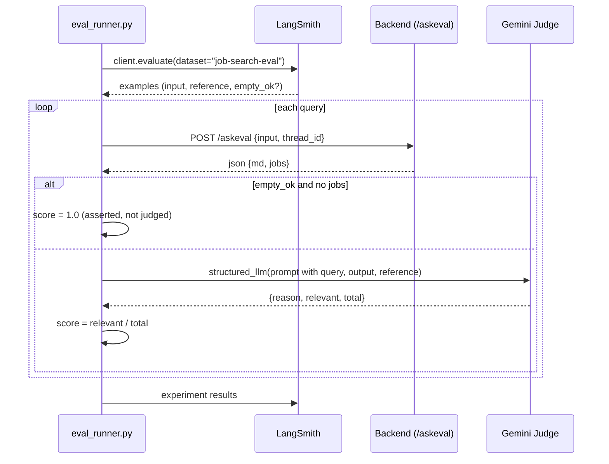

# LangSmith Eval

`eval_runner.py` is a LangSmith-backed regression harness that measures end-to-end search quality. It runs against live job boards, so individual cases wobble between runs — the aggregate is the signal.

## How it works



*The eval runner posts each query to `/askeval`, receives both a Markdown summary and the raw jobs list, and asks a Gemini judge to count how many returned listings match the reference criteria.*

## Implementation

The grading logic uses a Pydantic-structured LLM to ensure consistent counting:

```python
class Output(BaseModel):
    reason : str
    relevant : int
    total : int = Field(ge=1)

structured_llm = llm.with_structured_output(Output)
```

The grading prompt defines the judge's behavior:

1.  **Strict Counting**: Total is the number of listings returned; relevant is the number that satisfy the reference criteria.
2.  **Listing Isolation**: Rejected listings only subtract from the score and do not invalidate others.
3.  **Default Inclusion**: When criteria are silent about a listing, it is counted as relevant.
4.  **Empty Assertions**: If no jobs are returned and the query is marked `empty_ok`, the score is automatically 1.0.

### Test execution
Each query is assigned a random `uuid` as a `thread_id` to ensure stateless execution. The runner enforces a 180-second timeout per query.

## Running

```bash
python eval_runner.py
```

Requires `LANGSMITH_API_KEY` and `GEMINI_API_KEY` in the environment. The runner posts to `http://localhost:8002/askeval` by default.

## Methodology

Changes to the agent are judged against a control run of the unchanged code on the same day. Because live job boards shift content frequently, a single code version can produce different scores on different days. Aggregate performance across the 24 cases is the primary metric for regressions.
