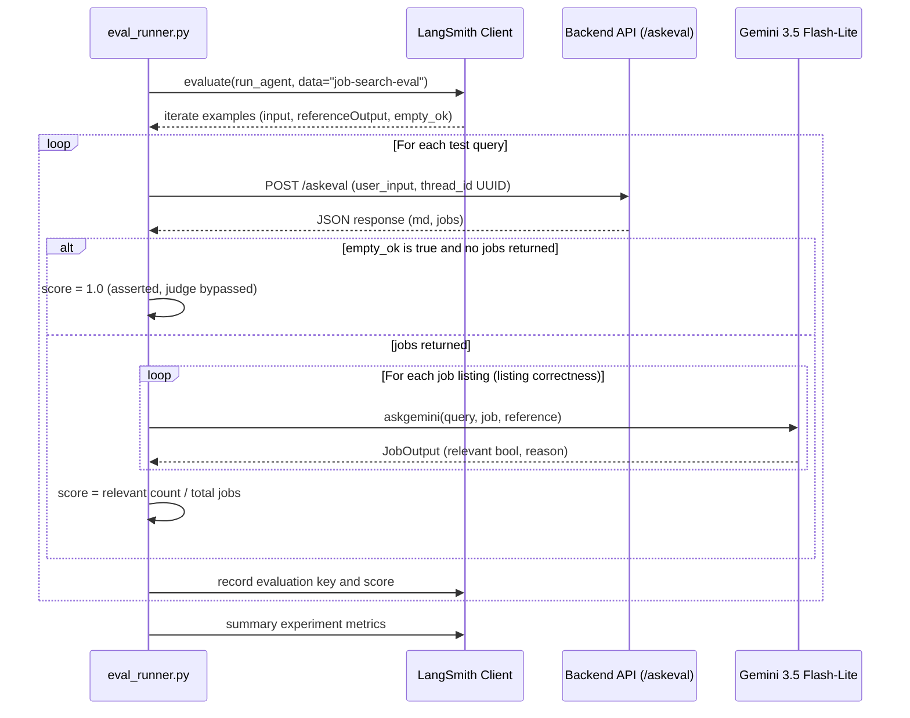

# LangSmith Evaluation & Tracing

LangSmith serves two roles in the system: end-to-end execution tracing for agent observability and an automated live LLM-as-a-judge evaluation harness (`eval_runner.py`). Because the job search agent queries live job boards whose inventory shifts hourly, the evaluation harness measures aggregate precision across diverse test cases rather than relying on frozen mocks.

---

## LangSmith Tracing Configuration

LangSmith observability traces every node execution, latency, error state, and token count across LangGraph workflows. Graph runs are observable via the LangChain / LangSmith SDK runtime integration. In the primary search path, LLM token usage is zero because search aggregation and filtering are deterministic; tokens appear primarily during user feedback extraction, CV uploads, and LLM evaluation runs.

### Environment Setup & Region Endpoints

LangSmith supports distinct regional control planes for data residency and latency optimization. Endpoint configuration depends on whether the organization operates in the United States or the European Union:

| Variable | Required | Description / Region Endpoint |
|---|---|---|
| `LANGSMITH_TRACING` | Required | Set to `"true"` to enable active tracing (alias: `LANGCHAIN_TRACING_V2`). |
| `LANGSMITH_API_KEY` | Required | LangSmith workspace API key (alias: `LANGCHAIN_API_KEY`). |
| `LANGSMITH_PROJECT` | Optional | Destination project name (defaults to `default`, alias: `LANGCHAIN_PROJECT`). |
| `LANGSMITH_ENDPOINT` | Region-dependent | API endpoint URL (alias: `LANGCHAIN_ENDPOINT`). |

#### Regional Endpoints

- **US Region (Default)**: `https://api.smith.langchain.com` (can be omitted in standard setups as the SDK defaults to the US cloud).
- **EU Region**: `https://eu.api.smith.langchain.com` (must be explicitly configured when hosting workspaces in the EU data residency zone).

### Configuration in Deployment and CI

1. **Production Deployment (`render.yaml`)**:
   The Frankfurt-based backend web service specifies:
   ```yaml
   - key: LANGSMITH_TRACING
     value: "true"
   - key: LANGSMITH_ENDPOINT
     value: https://eu.api.smith.langchain.com
   - key: LANGSMITH_API_KEY
     sync: false
   - key: LANGSMITH_PROJECT
     sync: false
   ```
2. **Local Environment (`.env.example`)**:
   ```bash
   LANGSMITH_TRACING=true
   LANGSMITH_API_KEY=lsv2_...
   LANGSMITH_PROJECT=jobsearch-dev
   LANGSMITH_ENDPOINT=https://eu.api.smith.langchain.com  # EU region
   ```
3. **Automated CI Workflows (`.github/workflows/openwiki-update.yml`)**:
   GitHub Actions exports both modern and legacy variables to ensure complete toolchain compatibility across differing LangChain tooling:
   ```yaml
   LANGCHAIN_TRACING_V2: "true"
   LANGCHAIN_PROJECT: openwiki-ci
   LANGSMITH_ENDPOINT: https://eu.api.smith.langchain.com
   LANGCHAIN_ENDPOINT: https://eu.api.smith.langchain.com
   LANGSMITH_API_KEY: ${{ secrets.LANGSMITH_API_KEY }}
   ```

---

## Live Evaluation Harness (`eval_runner.py`)

The evaluation runner (`eval_runner.py`) drives automated benchmarks against the running backend API using `langsmith.Client().evaluate()`.

### The `job-search-eval` Dataset Structure

The benchmark runs against the `job-search-eval` LangSmith dataset, composed of 24 real-world test cases:

- **Inputs (`example.inputs["input"]`)**: Raw search query strings covering distinct query types:
  - *Narrow niches*: `rust`, `blockchain solidity`
  - *Vague requests*: `remote job`
  - *Intentional typos*: `pyton developer` (typos are deliberately not auto-corrected; expected behavior is returning no matching listings)
  - *Zero-result queries*: `COBOL mainframe developer` (queries where live boards rarely have matching postings)
  - *Live demo user queries*: `Remote React jobs` and `Fullstack react remote jobs` (added after production query logs revealed real-world query variations returning empty sets)
- **Outputs (`example.outputs["referenceOutput"]`)**: Written criteria detailing specifically what makes a job listing relevant and what disqualifies it.
- **Empty Output Flag (`example.outputs["empty_ok"]`)**: A boolean flag set on intentional typos and obscure niches. If the agent returns zero listings for an `empty_ok` query, the harness automatically asserts a score of `1.0` without calling an LLM judge.

### Execution Isolation and `/askeval`

To ensure clean evaluation measurements:
- The runner POSTs queries to the dedicated backend endpoint `http://localhost:8002/askeval` (authenticated via the `EVALS` key sent in the `x-api-key` header).
- Each request generates a fresh `uuid.uuid4()` as its `thread_id` to guarantee stateless execution.
- Requests enforce a strict 180-second timeout per query.
- The backend routes `/askeval` through `eval_agent` backed by `InMemorySaver` rather than the Postgres-backed production checkpointer, and bypasses the 4-hour Redis search cache entirely so that evals always measure live board fetching and filtering.

---

## Evaluation Architecture Flow



*LangSmith evaluation loop posting test cases to `/askeval` and scoring individual job listings with Gemini 3.5 Flash-Lite.*

---

## Evaluation Keys and Scoring Logic

The evaluation harness implements structured LLM judges powered by Google's `google_genai:gemini-3.5-flash-lite` (configured via `init_chat_model` with `max_retries=10`). Output schemas are enforced with Pydantic models.

### 1. Per-Job Listing Correctness (`gemini35lite_listing_correctness`)

The primary active evaluator in `eval_runner.py` grades each job listing individually rather than scoring the response as a lump sum:

- **Evaluation Key**: `gemini35lite_listing_correctness`
- **Pydantic Schema**:
  ```python
  class JobOutput(BaseModel):
      reason: str
      relevant: bool

  eachjob_structured_llm = llm.with_structured_output(JobOutput)
  ```
- **Prompt Guidelines**:
  - The judge receives the search query, the reference criteria, and the job's title, description, and application URL.
  - *Default inclusion*: When criteria are silent about a listing, it counts as relevant.
  - *Target of exclusions*: Exclusions apply strictly to the role itself. Mention of company products or secondary applicant criteria does not disqualify the listing.
  - *Role focus*: A role leaning toward one facet is not excluded (e.g., a backend-focused full stack role remains full stack).
- **Scoring Ratio**:
  $$\text{final\_score} = \frac{\sum \text{relevant}}{\text{total listings judged}}$$
- **Empty Output Behavior**:
  - If `empty_ok` is true and no jobs are returned: score is `1.0` (asserted).
  - If `empty_ok` is false and no jobs are returned: score is `0.0`.

### 2. Full Response Correctness (`gemini_full_correctness`)

An alternative whole-response evaluator that grades the entire formatted markdown output:

- **Evaluation Key**: `gemini_full_correctness`
- **Pydantic Schema**:
  ```python
  class Output(BaseModel):
      reason: str
      relevant: int
      total: int = Field(ge=1)

  structured_llm = llm.with_structured_output(Output)
  ```
- **Prompt Rules**:
  - `total`: Number of job listings present in the agent's markdown response.
  - `relevant`: How many listings satisfy the reference criteria based solely on job title and description.
  - *Strict listing isolation*: A rejected listing subtracts one from `relevant` and nothing more; it never invalidates other returned listings.
  - *No penalization for omissions*: Missing listings that the judge expected do not lower the score (precision metric, not recall).
- **Scoring Ratio**:
  $$\text{score} = \frac{\text{relevant}}{\text{total}}$$
- **Empty Output Behavior**:
  - If `empty_ok` is true and no listings are returned: score is `1.0` (asserted).
  - If an empty response is evaluated by the judge: prompt instructs setting `total = 1`, and `relevant = 1` if criteria accept empty, else `0`.

### 3. Alternative Comparative Evaluators

`eval_runner.py` includes additional evaluators used to identify judge blind spots:
- **Jev (`jev_correctness`)**: Uses TypeSafe's `typesafe/jev-1.13` decision model via OpenRouter API (`https://openrouter.ai/api/alpha/decisions`). It evaluates listings individually, classifying any listing with probability $\ge 0.5$ as relevant.
- **Laya (`laya_ml_correctness`)**: Evaluates listings via a local container running HuggingFace's `multilingual` model. Benchmarking revealed Laya was excessively lenient (scoring 0.899 by accepting freight broker listings for LangChain agent roles), demonstrating why multi-judge validation is necessary.

The standard execution configuration in `eval_runner.py` pairs Jev and Gemini 3.5 Flash-Lite side-by-side:
```python
client.evaluate(
    run_agent,
    data="job-search-eval",
    evaluators=[jev_correctness, gemini_listing_correctness],
    experiment_prefix="gemini35lite-jev-perjob"
)
```

---

## Methodology & Historical Progression

### Same-Day Control Discipline

Because the agent queries live external job boards, the underlying job inventory changes constantly. The exact same code version scored `0.82` and then `0.765` five days later solely due to external market changes. An individual query such as `rust` swung from `1.0` to `0.5` without any code modification.

Therefore, changes to the agent are **always evaluated against a control run of the unchanged code executed on the same day**, never against a static baseline from a previous week.

### Historical Score Progression

The baseline progression across the standard 22 test cases:

| Change Iteration | Score | Notes |
|---|---|---|
| Initial agent implementation | 0.558 | Naive board aggregation |
| Stopped trusting RemoteOK tags | 0.575 | Matched explicitly on titles |
| Removed guaranteed minimum of 8 results | 0.679 | Stopped padding relevant results with weak matches |
| Treated `developer` / `engineer` as meaningful | 0.584 | Degraded score; reverted |
| Fixed reference criteria for typo queries | 0.751 | Handled intentional empty returns correctly |
| Fixed missing comma in generic words list | 0.812 | Prevented accidental string concatenation |
| Generic word tie-breaking (same-day control: 0.765) | 0.780 | Allowed generic words to break title ties |
| Description frequency scoring + no 10-result truncation (same-day control: 0.76) | 0.820 | Counted word frequency in descriptions |

With the addition of two live demo queries (`Remote React jobs` and `Fullstack react remote jobs`) and refined reference specifications, the baseline reached **~0.90 across 24 test cases** (measured August 16).

### Known Architectural Trade-Offs

- **Single title match admission**: A single title match admits a job listing into ranking. While necessary because specific terms (such as `sql`, `aws`, `pytorch`) appear in 0% of job titles (boards use broader titles like "DevOps Engineer"), it admits false positives for ambiguous words (e.g., `data` admitting Data Analysts).
- **Precision over recall**: Because the metric is precision ($\frac{\text{relevant}}{\text{returned}}$), a query returning two correct listings scores a perfect `1.0`, even if dozens of other matching jobs existed on the boards.

---

## Running the Evaluation

To execute the evaluation harness locally:

```bash
python eval_runner.py
```

### Environment Requirements

- `LANGSMITH_API_KEY`: API key for publishing run traces and experiment results to LangSmith.
- `LANGSMITH_ENDPOINT`: Regional endpoint URL (e.g., `https://eu.api.smith.langchain.com` if using EU region).
- `GEMINI_API_KEY`: API key for Gemini 3.5 Flash-Lite judge invocations.
- `EVALS`: Secret token passed in the `x-api-key` header to authenticate against `http://localhost:8002/askeval`.
- `OPENROUTER_API_KEY`: Required if running `jev_correctness` evaluator.
- Backend instance running on `http://localhost:8002`.

---

## Related Documentation

- [Backend API](../architecture/backend-api.md) — Documentation of `/askeval`, `eval_agent`, and authentication mechanisms.
- [Harbor Evaluation](harbor-eval.md) — Deterministic evaluation harness for filter persistence and rule validation.
- [Testing & Quality](../testing.md) — Comprehensive testing suite including unit, integration, and eval runners.
- [Operations & Deployment](../operations.md) — Production environment configuration and secret management.
