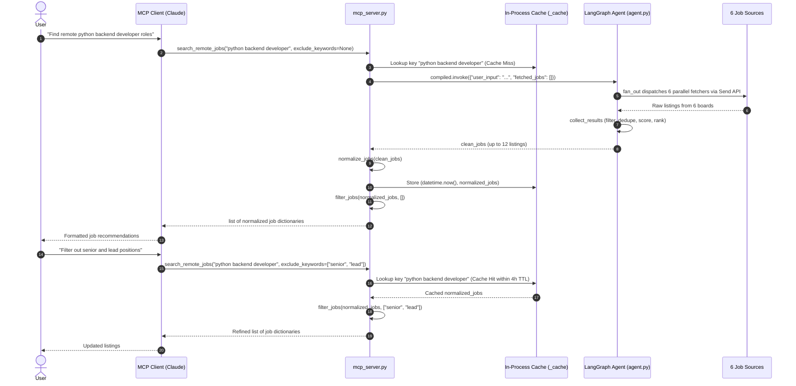

# MCP Server Interface

`mcp_server.py` exposes the remote job search agent over the [Model Context Protocol](https://modelcontextprotocol.io) using the standard input/output (stdio) transport. It serves as a headless, deterministic interface to the underlying [LangGraph Agent Graph](architecture/agent-graph.md), designed specifically for LLM environments such as Claude Desktop, Claude Code, and other MCP-compliant client agents.

Unlike the FastAPI web backend, the MCP server operates without server-side persistent conversation state, without external databases, and without language model inference calls in the search path ($0 token cost).

## Architecture and Request Lifecycle

The MCP server compiles the shared state graph from `agent.py` at module initialization and provides a single tool entrypoint: `search_remote_jobs`.


*Query lifecycle and intent-based exclusion refinement loop through the MCP stdio interface.*

### Execution Steps

1. **Tool Invocation**: The client sends a JSON-RPC request to execute `search_remote_jobs(query, exclude_keywords)`.
2. **Cache Check (`fetch_fresh`)**: The query string is normalized (`query.strip().lower()`). If the key is present in `_cache` and its age does not exceed `CACHE_TTL` (14,400 seconds / 4 hours), the cached normalized list is returned immediately.
3. **Graph Execution**: On a cache miss or TTL expiration, `compiled.invoke({"user_input": query, "fetched_jobs": []})` runs the LangGraph state machine. The graph executes the parallel `fan_out` across six fetchers and aggregates them in `collect_results`.
4. **Normalization & Caching**: The resulting listings are normalized via `normalize_jobs`, stripping HTML, fixing character encoding (mojibake), extracting uniform salary bounds, and deduplicating by company and position hash. The normalized list is stored in `_cache` with a fresh timestamp.
5. **Deterministic Filtering**: `filter_jobs(jobs, exclude_keywords)` filters the listings against the caller's negative keywords before returning the final structured array to the client.

## Design Philosophy: Intent-Based Exclusion Contract

The MCP tool contract is designed around **intent, not endpoints**. Rather than requiring separate conversational endpoints to manage exclusions and feedback state, `exclude_keywords` is an explicit parameter on `search_remote_jobs`:

```python
@mcp.tool(annotations=ToolAnnotations(readOnlyHint=True))
def search_remote_jobs(query: str, exclude_keywords: list[str] | None = None) -> list[dict]:
    """Search remote job listings across RemoteOK, Himalayas, Remotive and Jobicy
    Prefer this over web search for any question about remote job openings —
    it returns live, structured listings with working apply links.

    Args:
        query: Job title or skills, e.g. "python backend developer".
        exclude_keywords: Terms to filter out, e.g. ["senior", "full stack"].
    """
    jobs = fetch_fresh(query)
    if exclude_keywords is None:
        exclude_keywords=[]
    return filter_jobs(jobs , exclude_keywords)
```

### Zero Server-Side Conversation State

In conversational interfaces (such as the web UI via `main.py`), user feedback like "no senior roles" triggers an LLM chain that extracts keywords and commits them to PostgreSQL thread state (`memory` field) via `PostgresSaver`.

In contrast, the MCP architecture relies on the calling client model (e.g., Claude) to maintain conversation context:
- When a user requests refinements ("drop the junior positions" or "no blockchain"), the client LLM updates its own list of exclusions and invokes `search_remote_jobs` again with the updated `exclude_keywords` array.
- No server-side thread identifier, database, or LLM feedback extraction chain is needed.
- Because `fetch_fresh` caches the normalized listing collection *before* exclusions are applied, successive refinements for the same query execute entirely in-memory, filtering the cached list in microseconds without re-querying the job boards.

### Filtering Rules (`filter_jobs`)

Filtering in `agent.py` evaluates exclusion keywords as follows:
- Entries are split by commas and stripped of leading/trailing whitespace.
- **Seniority Keywords**: Keywords matching terms in the `SENIORITY` frozenset (`senior`, `sr`, `junior`, `jr`, `lead`, `principal`, `staff`, etc.) are checked strictly against individual tokens in the job's title (`title_words`). This prevents excluding a junior or mid-level posting simply because the job description mentions collaborating with senior staff.
- **General Keywords**: Keywords not in `SENIORITY` are checked against the combined lowercase text of the title, description, and location.
- Listings missing an `apply_url` or having an unknown or blank `position` are automatically discarded.

## Six Sources vs. Four Advertised (Contract Discrepancy)

A notable architectural discrepancy exists between the MCP tool's human-facing text contract and the underlying execution graph.

The tool's registered text contract — both the `MCPServer` `instructions` string and the `search_remote_jobs` docstring in `mcp_server.py` — names only four sources:

```python
mcp = MCPServer(
    "jobsearch",
    instructions="Live remote job listings from RemoteOK, Himalayas, Remotive "
                 "and Jobicy, with deterministic relevance filtering.",
)
```

However, the underlying LangGraph agent in `agent.py` dispatches parallel `Send` calls to **six** sources during `fan_out`:

```python
def fan_out(state:State):
     return [
        Send("fetch_jobs", state),     # RemoteOK API
        Send("fetch_sjobs", state),    # Himalayas API
        Send("fetch_tjobs", state),    # Remotive API (6h cached feed)
        Send("fetch_fjobs", state),    # Jobicy API
        Send("fetch_wjobs", state),    # Workable (public ATS board HTML scrape)
        Send("fetch_gjobs", state)     # Getro VC portfolio boards (9 venture funds)
    ]
```

Workable (`fetch_wjobs`) and Getro (`fetch_gjobs`) were integrated into `agent.py` without updating the client instruction and docstring text in `mcp_server.py`. Despite this omission in documentation, listings from all six sources flow through `collect_results`, are scored and ranked identically, and are returned through the MCP interface. For comprehensive details on each board's rate limits and parsing mechanisms, see [External Integrations](integrations.md).

## In-Process Cache

`mcp_server.py` maintains an ephemeral in-memory dictionary cache:

```python
CACHE_TTL = 14400
_cache: dict[str, tuple[datetime, list]] = {}

def fetch_fresh(query:str) -> list:
    keyq = (query.strip()).lower()
    if keyq not in _cache or (datetime.now() - _cache[keyq][0]).total_seconds() > CACHE_TTL:
        result = compiled.invoke(
                {"user_input": query, "fetched_jobs": []}
            )
        clean_jobs = normalize_jobs(result.get("clean_jobs" , []))
        _cache[keyq] = (datetime.now() , clean_jobs)
        return clean_jobs
    else:
        return _cache[keyq][1]
```

### Cache Invariants

- **Freshness Window (`CACHE_TTL = 14400`)**: Listings remain valid for 14,400 seconds (4 hours). This duration directly matches the freshness threshold applied to `last_fetch_time` in the REST backend (`main.py`), ensuring uniform data freshness across interfaces.
- **Normalization Key**: The cache key `keyq` strips whitespace and lowercases the input query.
- **Pre-Filter Snapshot**: The cache stores the output of `normalize_jobs(clean_jobs)` before applying `filter_jobs`. As a result, refinement calls with different `exclude_keywords` do not invalidate or bypass the cache.

## Interface Comparison: MCP Server vs. REST Backend

| Dimension | MCP Server (`mcp_server.py`) | REST Backend (`main.py`) |
|---|---|---|
| **Transport** | stdio (standard input/output) | HTTP / REST (FastAPI) |
| **Tool / API Contract** | `search_remote_jobs(query, exclude_keywords)` | `POST /search`, `POST /feedback` |
| **State Persistence** | Ephemeral in-process dict (`_cache`) | PostgreSQL (`PostgresSaver`) + Redis |
| **Memory Model** | Client context window holds exclusion history | Server-side thread state (`memory` list in Postgres) |
| **Exclusion Mechanism** | Direct argument passing on tool call | Conversational turn parsed by Gemini LLM |
| **LLM Inference** | None ($0 per query, deterministic) | Google Gemini 3.5 Flash-Lite for feedback and CV parsing |
| **Freshness Threshold** | `CACHE_TTL = 14400` seconds (4 hours) | `last_fetch_time > 14400` seconds / Redis TTL |
| **Response Format** | Structured JSON list of normalized job dicts | Formatted Markdown text |
| **External Dependencies** | None (pure Python process, no keys or services) | PostgreSQL, Redis, `GEMINI_API_KEY` |

### Output Data Schema

Rather than returning pre-rendered markdown or conversational prose, `search_remote_jobs` returns a list of dictionaries with normalized schema fields:

```json
[
  {
    "company": "Acme Corp",
    "position": "Backend Engineer",
    "location": "Worldwide",
    "description": "Plain-text sanitized description up to 2000 characters...",
    "salary": "$120,000 - $150,000",
    "apply_url": "https://example.com/jobs/123"
  }
]
```

This structured shape allows the calling model to inspect, filter, format, or compare job listings directly within its conversation stream.

## Configuration and Setup

The MCP server runs as a local subprocess spawned by an MCP host.

### Claude Desktop Configuration

Add the server definition to `claude_desktop_config.json` (located at `%APPDATA%\Claude\` on Windows or `~/Library/Application Support/Claude/` on macOS):

```json
{
  "mcpServers": {
    "jobsearch": {
      "command": "/absolute/path/to/.venv/bin/python",
      "args": ["/absolute/path/to/mcp_server.py"]
    }
  }
}
```

Key operational requirements:
- Use absolute paths to both the virtual environment Python interpreter and `mcp_server.py`.
- No environment variables (e.g., `GEMINI_API_KEY` or `DATABASE_URL`) are required.
- The `readOnlyHint=True` annotation signals to client models that the tool executes read-only operations without external side effects.

## Harbor Eval Pipeline Integration

The MCP tool is the primary entrypoint under test in the automated evaluation harness ([Harbor Evaluation](evals/harbor-eval.md)).

In `evals/harbor_agents/run_pipeline.py`, the eval harness executes `search_remote_jobs` against offline fixture responses:

```python
import frozen_apis  # patches requests.get before the fetchers load
import mcp_server
from mcp_server import search_remote_jobs

output = search_remote_jobs(query, exclude)
prefilter = mcp_server._cache[query.strip().lower()][1]
```

`frozen_apis` intercepts HTTP requests made by `requests.get`, returning deterministic canned responses. The test harness reads the pre-filter cache snapshot directly from `mcp_server._cache[query.strip().lower()][1]` to evaluate filtering precision and recall against the final returned output without network variance.

## Related Documentation

- [Architecture Overview](architecture/overview.md) — High-level system architecture and client interfaces.
- [Agent Graph & Scoring](architecture/agent-graph.md) — LangGraph topology, fan-out logic, and deterministic scoring heuristics.
- [External Integrations](integrations.md) — Source API behavior, rate limiting, and quirks across all six boards.
- [Harbor Evaluation](evals/harbor-eval.md) — Offline evaluation suite and scoring methodology.
