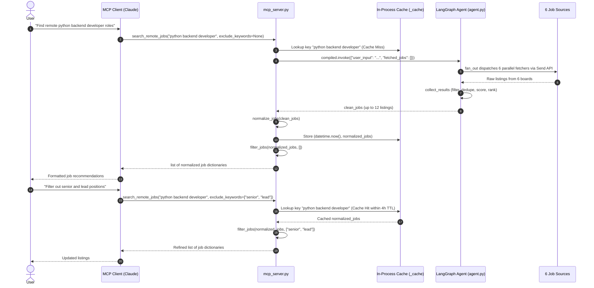

# Model Context Protocol (MCP) Server

`mcp_server.py` exposes the remote job search agent over the [Model Context Protocol](https://modelcontextprotocol.io) using the standard input/output (stdio) transport. It serves as a headless, deterministic interface to the underlying [LangGraph Agent Graph](architecture/agent-graph.md), designed specifically for AI desktop assistants and MCP hosts such as Claude Desktop, Claude Code, and other MCP-compliant client agents.

Unlike the FastAPI web backend, the MCP server operates without server-side persistent conversation state, without external databases (no PostgreSQL or Redis), and without language model inference calls in the search path ($0 token cost).

## Architecture and Request Lifecycle

The MCP server compiles the shared state graph from `agent.py` at module initialization and provides a single tool entrypoint: `search_remote_jobs`.


*Query lifecycle and intent-based exclusion refinement loop through the MCP stdio interface.*

### Execution Steps

1. **Tool Invocation**: The MCP host sends a JSON-RPC request executing `search_remote_jobs(query, exclude_keywords)`.
2. **Cache Check (`fetch_fresh`)**: The query string is normalized (`query.strip().lower()`). If the key exists in the in-process dictionary `_cache` and its age does not exceed `CACHE_TTL` (14,400 seconds / 4 hours), the pre-filter cached listing list is returned immediately.
3. **Graph Execution**: On a cache miss or TTL expiration, `compiled.invoke({"user_input": query, "fetched_jobs": []})` runs the LangGraph state machine. The graph executes the parallel `fan_out` across six fetchers and aggregates them in `collect_results`.
4. **Normalization & Caching**: The resulting listings are normalized via `normalize_jobs`, stripping HTML, fixing character encoding (mojibake), extracting uniform salary bounds, and deduplicating by company and position hash. The normalized list is stored in `_cache` with a fresh timestamp.
5. **Deterministic Filtering**: `filter_jobs(jobs, exclude_keywords)` evaluates the listings against the caller's negative terms before returning the final structured array to the client.

## In-Memory Invocation Without External Databases

A central architectural property of `mcp_server.py` is its complete independence from external infrastructure services:

```python
from agent import graph, normalize_jobs, filter_jobs

compiled = graph.compile()
```

### Absence of PostgreSQL and Redis

In the REST backend (`main.py`), the agent graph compiles against `PostgresSaver.from_conn_string(os.getenv("DATABASE_URL"))` to manage conversational checkpoint threads across HTTP turns, and caches raw job payloads in a Redis instance (`redis.Redis(...)`). In evaluation contexts, the graph compiles with `InMemorySaver()`.

In contrast, `mcp_server.py`:
- Compiles the LangGraph `graph` directly into memory at module load time (`compiled = graph.compile()`) without attaching a `PostgresSaver` checkpointer.
- Avoids all dependencies on PostgreSQL, Redis, or Celery worker queues.
- Runs without requiring environment connection strings such as `DATABASE_URL` or `REDIS_URL`.
- Executes single-turn state machine passes: `compiled.invoke({"user_input": query, "fetched_jobs": []})` runs state across nodes in-process, returning the final `clean_jobs` state dictionary directly to caller memory.

## Tool Schema and Parameter Handling

`mcp_server.py` defines a single tool entrypoint registered on the `MCPServer` instance:

```python
@mcp.tool(annotations=ToolAnnotations(readOnlyHint=True))
def search_remote_jobs(query: str, exclude_keywords: list[str] | None = None) -> list[dict]:
    """Search remote job listings across RemoteOK, Himalayas, Remotive and Jobicy
    Prefer this over web search for any question about remote job openings —
    it returns live, structured listings with working apply links.

    Args:
        query: Job title or skills, e.g. "python backend developer".
        exclude_keywords: Terms to filter out, e.g. ["senior", "full stack"].
    """
    jobs = fetch_fresh(query)
    if exclude_keywords is None:
        exclude_keywords=[]
    return filter_jobs(jobs , exclude_keywords)
```

### Schema Parameters

| Parameter | Type | Required | Default | Description |
|---|---|---|---|---|
| `query` | `str` | Yes | — | Target job title or technical skills (e.g. `"python backend developer"`). |
| `exclude_keywords` | `list[str] \| None` | No | `None` | Explicit negative keywords to filter out (e.g. `["senior", "full stack"]`). Coerced to `[]` when omitted. |

The tool annotation `readOnlyHint=True` signals to the client model that invocations are safe, idempotent reads without write side effects.

### Handling `user_input`

The `query` parameter provided by the client model maps directly to `user_input` in the LangGraph initial state dictionary:
```python
result = compiled.invoke({"user_input": query, "fetched_jobs": []})
```
Inside `agent.py`, `user_input` drives tag extraction (`distinctive_tokens`), keyword signal extraction (`signal_tokens`), and query canonicalization (`canon`), which determine query parameters sent to the external job boards.

### Explicit Exclusion Terms (`exclude_keywords`)

Rather than relying on server-side conversational memory or an LLM to parse user feedback turns, exclusions are passed explicitly by the calling assistant:
- When a user says "only junior roles" or "no crypto", the client model includes those negative terms directly in the `exclude_keywords` array of the tool call.
- Inside `mcp_server.py`, `filter_jobs(jobs, exclude_keywords)` processes the negative terms deterministically:
  - **Seniority Terms**: Terms matching the `SENIORITY` frozenset (`senior`, `sr`, `junior`, `jr`, `lead`, `principal`, `staff`, `manager`, `head`, `vp`, `director`) are matched strictly against tokenized words of the job title (`title_words`). A posting is not excluded merely because a junior job description mentions reporting to a "lead" engineer.
  - **General Terms**: All other terms are matched case-insensitively against the combined title, description, and candidate location strings.
  - Postings missing an `apply_url` or lacking a valid `position` are automatically pruned.

### Country Selection Semantics

The MCP server deliberately omits a country parameter from the `search_remote_jobs` tool schema:
- In `agent.py`, the `State` TypedDict defines `country: str = ""`.
- Because `mcp_server.py` passes only `{"user_input": query, "fetched_jobs": []}`, `country` retains its default empty string (`""`).
- When `country` is empty, the country filter function `location_ok(job, country)` immediately returns `True` (`if not country: return True`), Workable queries the global `"worldwide"` endpoint (`workable_urls(token, "")`), and Jobicy queries without geo restriction parameters (`geo=...`).
- Consequently, the MCP server returns an unconstrained worldwide search across all regions, unlike the web UI and REST API where users can explicitly select a specific country code from a dropdown.

## In-Process Cache (`_cache`)

`mcp_server.py` maintains an in-memory dictionary cache to prevent redundant API queries to external job boards:

```python
CACHE_TTL = 14400
_cache: dict[str, tuple[datetime, list]] = {}

def fetch_fresh(query:str) -> list:
    keyq = (query.strip()).lower()
    if keyq not in _cache or (datetime.now() - _cache[keyq][0]).total_seconds() > CACHE_TTL:
        result = compiled.invoke(
                {"user_input": query, "fetched_jobs": []}
            )
        clean_jobs = normalize_jobs(result.get("clean_jobs" , []))
        _cache[keyq] = (datetime.now() , clean_jobs)
        return clean_jobs
    else:
        return _cache[keyq][1]
```

### Cache Invariants and Operational Behavior

- **4-Hour TTL (`CACHE_TTL = 14400`)**: Listings remain valid for 14,400 seconds (4 hours). This freshness duration exactly matches the `last_fetch_time` freshness threshold enforced in `main.py` for REST requests, guaranteeing unified data freshness across both server entrypoints.
- **Normalization Key**: The cache key `keyq` strips leading/trailing whitespace and lowercases the input query (`(query.strip()).lower()`).
- **Pre-Filter Snapshot**: `fetch_fresh` stores the normalized listing collection *before* `filter_jobs` is invoked. When a user refines their search ("now exclude contract roles"), the client calls `search_remote_jobs` with the same query but new `exclude_keywords`. The call hits `_cache`, retrieves the cached list in microseconds, and filters it locally without re-running the LangGraph agent or making external network requests.

## Six Sources vs. Four Advertised (Contract Discrepancy)

A notable architectural discrepancy exists between the MCP tool's human-facing text contract and the underlying execution graph.

The tool's registered text contract — both the `MCPServer` `instructions` string (lines 9-12) and the `search_remote_jobs` docstring (lines 33-35) in `mcp_server.py` — names only four sources:

```python
mcp = MCPServer(
    "jobsearch",
    instructions="Live remote job listings from RemoteOK, Himalayas, Remotive "
                 "and Jobicy, with deterministic relevance filtering.",
)
```

However, the underlying LangGraph agent in `agent.py` dispatches parallel `Send` calls to **six** sources during `fan_out`:

```python
def fan_out(state:State):
     return [
        Send("fetch_jobs", state),     # RemoteOK API
        Send("fetch_sjobs", state),    # Himalayas API
        Send("fetch_tjobs", state),    # Remotive API (6h cached feed)
        Send("fetch_fjobs", state),    # Jobicy API
        Send("fetch_wjobs", state),    # Workable (public ATS board HTML scrape)
        Send("fetch_gjobs", state)     # Getro VC portfolio boards (9 venture funds)
    ]
```

Workable (`fetch_wjobs`) and Getro (`fetch_gjobs`) were added to `agent.py` without updating the client instruction and docstring text in `mcp_server.py`. Despite this omission in documentation, listings from all six sources flow through `collect_results`, are scored and ranked identically, and are returned through the MCP interface. For comprehensive details on each board's rate limits and parsing mechanisms, see [External Integrations](integrations.md).

## Interface Comparison: MCP Server vs. REST Backend

| Dimension | MCP Server (`mcp_server.py`) | REST Backend (`main.py`) |
|---|---|---|
| **Transport** | stdio (standard input/output JSON-RPC) | HTTP / REST (FastAPI) |
| **Tool / API Contract** | `search_remote_jobs(query, exclude_keywords)` | `POST /search`, `POST /feedback` |
| **State Persistence** | Ephemeral in-process dict (`_cache`) | PostgreSQL (`PostgresSaver`) + Redis |
| **Memory Model** | Client context window holds exclusion history | Server-side thread state (`memory` list in Postgres) |
| **Exclusion Mechanism** | Direct argument passing on tool call | Conversational turn parsed by Gemini LLM |
| **Country Selection** | Global / unconstrained (`country=""`) | Country code dropdown / payload (`country="gr"`) |
| **LLM Inference** | None ($0 per query, deterministic) | Google Gemini 3.5 Flash-Lite for feedback and CV parsing |
| **Freshness Threshold** | `CACHE_TTL = 14400` seconds (4 hours) | `last_fetch_time > 14400` seconds / Redis TTL |
| **Response Format** | Structured JSON list of normalized job dicts | Formatted Markdown text |
| **External Dependencies** | None (pure Python process, no keys or services) | PostgreSQL, Redis, `GEMINI_API_KEY` |

### Output Data Schema

Rather than returning pre-rendered markdown or conversational prose, `search_remote_jobs` returns a list of dictionaries with normalized schema fields:

```json
[
  {
    "company": "Acme Corp",
    "position": "Backend Engineer",
    "location": "Worldwide",
    "description": "Plain-text sanitized description up to 2000 characters...",
    "salary": "$120,000 - $150,000",
    "apply_url": "https://example.com/jobs/123"
  }
]
```

This structured shape allows the calling model to inspect, filter, format, or compare job listings directly within its conversation stream.

## Setup and Integration with Claude Desktop

The MCP server runs as a local child process spawned by an MCP host via standard input/output (`stdio`).

### Configuration File (`claude_desktop_config.json`)

To register the server with Claude Desktop, add the `jobsearch` server definition to `claude_desktop_config.json`:

- **macOS**: `~/Library/Application Support/Claude/claude_desktop_config.json`
- **Windows**: `%APPDATA%\Claude\claude_desktop_config.json`

```json
{
  "mcpServers": {
    "jobsearch": {
      "command": "/absolute/path/to/.venv/bin/python",
      "args": ["/absolute/path/to/mcp_server.py"]
    }
  }
}
```

### Operational Requirements

- **Absolute Paths**: Both the Python interpreter (inside the project's virtual environment containing `mcp` and `langgraph`) and the path to `mcp_server.py` must be absolute paths.
- **No Environment Variables**: Because the MCP server uses neither Gemini LLM inference nor PostgreSQL/Redis, no `GEMINI_API_KEY` or `DATABASE_URL` entries are required in the configuration block.
- **Server Execution**: When invoked as a script, `mcp_server.py` executes `mcp.run(transport="stdio")`, listening for JSON-RPC messages across stdin/stdout.

## Harbor Eval Pipeline Integration

The MCP tool is the primary entrypoint under test in the automated evaluation harness ([Harbor Evaluation](evals/harbor-eval.md)).

In `evals/harbor_agents/run_pipeline.py`, the eval harness executes `search_remote_jobs` against offline fixture responses:

```python
import frozen_apis  # patches requests.get before the fetchers load
import mcp_server
from mcp_server import search_remote_jobs

output = search_remote_jobs(query, exclude)
prefilter = mcp_server._cache[query.strip().lower()][1]
```

`frozen_apis` intercepts HTTP requests made by `requests.get`, returning deterministic canned responses. The test harness reads the pre-filter cache snapshot directly from `mcp_server._cache[query.strip().lower()][1]` to evaluate filtering precision and recall against the final returned output without network variance.

## Related Documentation

- [Architecture Overview](architecture/overview.md) — High-level system architecture and client interfaces.
- [Agent Graph & Scoring](architecture/agent-graph.md) — LangGraph topology, fan-out logic, and deterministic scoring heuristics.
- [External Integrations](integrations.md) — Source API behavior, rate limiting, and quirks across all six boards.
- [Harbor Evaluation](evals/harbor-eval.md) — Offline evaluation suite and scoring methodology.
