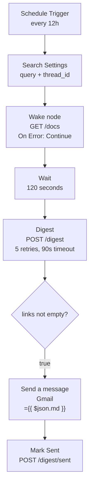

# n8n Automation

The included `n8n_workflow.json` adds automated job alerts every 12 hours. The workflow holds **no filtering or deduplication logic of its own** — it only schedules, calls the API, decides whether anything was found, and mails the result. Earlier versions duplicated keyword matching across JavaScript Code nodes, which meant every fix to the Python scoring had to be made twice. Now n8n delegates search *and* cross-run deduplication entirely to the backend.

The digest goes through the same LangGraph fan-out the web UI uses — five sources in parallel: RemoteOK, Himalayas, Remotive, Jobicy, and Workable (`fetch_wjobs`). The listings get the same normalization, mojibake repair, relevance ranking, and `MAX_RESULTS=12` cap as every other interface. What is new is a second backend call that records which links were mailed, so the workflow never sends the same job twice across runs.

## Node chain



*The n8n workflow: schedule → settings → wake the sleeping Render instance → wait for boot → call /digest → only mail when there are new listings → record what was sent.*

### Schedule Trigger

Fires every 12 hours.

### Search Settings

A Set node carrying `query` (default `python AI backend engineer remote`) and `thread_id` (default `YOUR_UNIQUE_THREAD_ID`). This is the only node you edit:
- Set `query` to whatever you are looking for
- Replace `YOUR_UNIQUE_THREAD_ID` with a value only you know — `python -c "import uuid;print(uuid.uuid4())"`

### Wake node

`GET /docs` with **On Error: Continue** (`onError: continueRegularOutput`), plus `retryOnFail: true`, `maxTries: 2`, `waitBetweenTries: 5000`. On a sleeping free-tier Render instance, the first request gets an immediate `503`, not a slow response. This node exists purely to trigger the boot. Failing is its normal outcome — the workflow continues regardless. (`GET /docs` is the wake ping; `/health` is the Render healthcheck — they are different endpoints.)

### Wait 120 seconds

After the wake ping, the workflow waits 120 seconds for the Render instance to finish booting. With the Celery worker sharing the same instance, the boot takes 70–80s. Without this wait, the subsequent `/digest` request would arrive before the server is ready.

### Digest

HTTP Request node, `POST /digest`, authenticated via the `httpHeaderAuth` (Header Auth) credential:
- `retryOnFail: true`
- `maxTries: 5`
- `waitBetweenTries: 5000` (5 seconds)
- `timeout: 90000` (90 seconds)
- JSON body `{ "user_input": ..., "thread_id": ... }` taken from Search Settings

n8n's retry ceiling (5 tries, 5s apart) covers ~25s of the ~50s cold start. The wake node + 120s wait covers the rest. The response is `{ "md": ..., "links": [...] }` — the formatted markdown body and the `apply_url` list of the listings that survived deduplication.

### If

An If node that checks `={{ $json.links }}` is non-empty (array `notEmpty`). Only the **true** branch continues to Gmail. A run that finds no new listings stops here and sends nothing.

### Send a message (Gmail)

Sends the `/digest` response field `md` as a plain-text email (`message: ={{ $json.md }}`, `emailType: text`) to the configured address, with `executeOnce: true`.

### Mark Sent

HTTP Request node, `POST /digest/sent`, also authenticated via `httpHeaderAuth`. It runs *after* Gmail succeeds and POSTs the links that were just mailed — `{"links": JSON.stringify($('Digest').item.json.links)}` — so the backend can record them.

## Backend behavior

The workflow's intelligence lives in two backend endpoints, both auth-gated by the `N8N_DEDUPE` token:

**`POST /digest`** runs the same search path as `/ask`: `searchhelper` → `normalize_jobs` → `filter_jobs` (which applies the thread's stored memory), producing the filtered job list. It then opens a Postgres connection, reads every `joblink` from the `n8njobs` table, and keeps only the jobs whose `apply_url` is not already in that set (adding each kept link to the in-memory set so duplicates within one run are also dropped). It returns `{ "md": ..., "links": [...] }` — the markdown digest and the `apply_url` list of the surviving listings. Note `/digest` uses the `N8N_DEDUPE` header for access, not the thread's filters directly — but `filter_jobs` still applies the thread memory set via `/feedback`.

**`POST /digest/sent`** takes `{ "links": [...] }` and inserts each link into `n8njobs` with `ON CONFLICT (joblink) DO NOTHING`. The insert is idempotent, so a retried call does no harm.

### Why two calls instead of one

A listing stays on the boards for weeks, so an alert that asks for "the best jobs today" would send the same ones every run. The backend remembers what was mailed in the `n8njobs` table. `/digest` only reads it and returns the new listings; the links are written by `/digest/sent`, which n8n calls only *after* Gmail succeeds. Writing them earlier would lose a run for good whenever the email failed after the search. The insert ignores links that are already there, so the worst case is now a repeated email, not a missing one — the workflow never emails the same job twice across runs. (n8n's own workflow static data was tried first and dropped: it never persisted between scheduled runs on this instance.)

Before the first run, create the table once in your Postgres:

```sql
create table n8njobs (joblink text primary key, added_at timestamptz not null default now());
```

## Setup

1. Import `n8n_workflow.json` into your n8n instance
2. Configure Gmail credentials in the Gmail node and set your address in **Send a message**
3. Configure a **Header Auth** credential whose header name is `x-api-key` and whose value is the same `N8N_DEDUPE` you set in the backend `.env`; both the Digest and Mark Sent nodes use it
4. In **Search Settings**, set `query` and replace `YOUR_UNIQUE_THREAD_ID` with a value only you know
5. Point the three HTTP nodes (Wake, Digest, Mark Sent) at your backend — `http://host.docker.internal:8002` from Docker, `http://localhost:8002` otherwise
6. Create the `n8njobs` table (above) and set `N8N_DEDUPE` in the backend `.env`

## Persistent filters

The thread outlives the workflow, so exclusions only need to be set once. Call `POST /feedback` with the same `thread_id` and something like `no senior, no staff`. Every later run reuses them, because `filter_jobs` reads the thread's stored memory during `/digest`. The response footer lists the filters that were actually stored — the extraction is done by an LLM and may generalize more than you intended.

## Security

Anyone who learns the `thread_id` can change that thread's filters via `/feedback`. Do not publish it.

The three closed endpoints are each gated by a separate token checked with `secrets.compare_digest` (constant-time):

| Endpoint | Token env var | Notes |
|----------|---------------|-------|
| `/digest`, `/digest/sent` | `N8N_DEDUPE` | The n8n workflow authenticates with these via the Header Auth credential |
| `/evaluate` | `EVALUATE_TOKEN` | AI scoring of arbitrary job text; not wired into this workflow |

Without the matching env var or the `x-api-key` header, each returns `401`. `/feedback` and `/upload` stay open (the public demo needs them) and are bounded by size instead.

## When to drop the wake/wait nodes

If your backend is always on (not a sleeping free-tier instance), drop both the **Wake node** and the **Wait node** — they exist only for cold-start handling.

## Source references

- `n8n_workflow.json` — the workflow definition (301 lines)
- `assets/n8n_workflow.jpg` — workflow screenshot
- `assets/email_digest.png` — email digest screenshot
- `main.py` — `/digest` (dedup against `n8njobs`, returns `{md, links}`), `/digest/sent` (`ON CONFLICT DO NOTHING`), `keycheck` / `secrets.compare_digest`, `/evaluate`
- `agent.py` — five-source fan-out (`fetch_wjobs` for Workable), `collect_results`, `MAX_RESULTS=12`

## See also

- [Backend API](../architecture/backend-api.md)
- [Integrations](../integrations.md)
- [Operations](../operations.md)
- [Workflows](../workflows.md)
