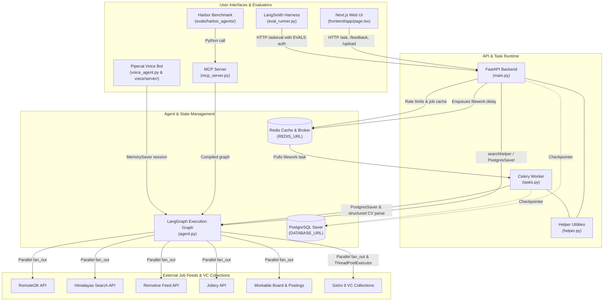
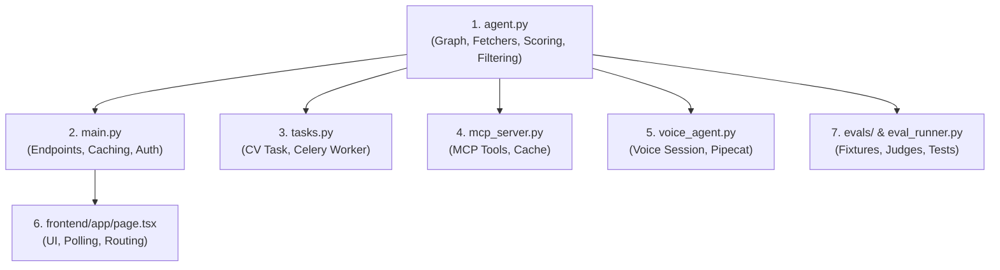

# Repository Source Map

This document provides a comprehensive structural and functional map of the repository. It indexes all modules, entry points, background execution pipelines, evaluation harnesses, and user interfaces, detailing their specific responsibilities, dependencies, and integration boundaries.

For dedicated architecture walkthroughs, see [System Overview](architecture/overview.md), [Agent Graph](architecture/agent-graph.md), [Backend API](architecture/backend-api.md), and [Quickstart](quickstart.md).

*Architecture and invocation map: interfaces dispatching through the backend API, Celery worker, and LangGraph engine across external job boards and VC networks.*

---

## Primary Entry Points

The codebase provides multiple distinct entry points tailored for browser chat, Model Context Protocol (MCP) clients, voice conversations, offline worker tasks, and automated evaluation frameworks:

| Path | Primary Role | Code Lines | Interfaces & Consumers |
|---|---|---|---|
| `main.py` | FastAPI application exposing 10 REST endpoints; manages Postgres/InMemory checkpointer lifespans, Redis caching/rate limiting/budgeting, `keycheck` auth dependencies, and Celery task dispatch. | ~334 | Web frontend (`frontend/app/page.tsx`), n8n automation (`n8n_workflow.json`), LangSmith evaluation runner (`eval_runner.py`). |
| `agent.py` | Deterministic LangGraph workflow compiling parallel job search across 6 sources (including 9 VC collections via Getro), title scoring, dedup, country/age filtering, and normalization. | ~655 | Imported directly by `main.py`, `mcp_server.py`, `voice_agent.py`, and `tasks.py`. |
| `mcp_server.py` | Model Context Protocol stdio server providing the read-only `search_remote_jobs` tool with in-process query caching (4h TTL). | ~47 | AI desktop clients (Claude Desktop), Harbor evaluation benchmark (`run_pipeline.py`). |
| `voice_agent.py` | Standalone voice session controller wrapping `agent.py` with an in-memory `MemorySaver` and local `last_jobs` buffer. | ~50 | Pipecat voice pipeline (`voice/server/langgraph_processor.py`). |
| `tasks.py` | Celery application and background worker task (`filework`) for asynchronous PDF CV parsing, Gemini keyword extraction, and agent execution. | ~36 | Enqueued by `POST /upload` in `main.py`, executed via Redis broker/result backend. |
| `frontend/app/page.tsx` | Next.js chat client featuring SSE streaming response consumption, local storage state persistence, country dropdown, and async CV polling. | ~423 | Web browser users. |
| `eval_runner.py` | LangSmith evaluation harness invoking `/askeval` and executing multi-model LLM grading across Gemini, Jev, and Laya judges. | ~237 | CI pipelines and model performance benchmarking. |

---

## Core Execution Engine: `agent.py`

`agent.py` (~655 lines) is the central source of truth for all job retrieval, deduplication, scoring, filtering, and normalization across the entire system. Crucially, the search path is strictly deterministic: no LLM is executed inside the graph itself.

### State & Constants
- `State` (`TypedDict`): Holds `fetched_jobs` (annotated with reducer `add_or_reset`), `clean_jobs` (`list[dict]`), `last_fetch_time` (`str`), `current_job` (`dict`), `user_input` (`str`), `country` (`str`), and `memory` (`list[str]`, annotated with `add_or_reset`).
- `TITLE_WEIGHT` (10), `MAX_RESULTS` (12), `MAX_AGE_DAYS` (120), `TAG_LIMIT` (3), `ENOUGH` (50).
- `SENIORITY`: Frozenset of seniority tokens (`senior`, `sr`, `junior`, `lead`, `principal`, `staff`, `mid`, `entry`, `pleno`, `sênior`, `head`, `director`, `vp`, `chief`).
- `GENERIC`: Common job search terms ignored during signal token extraction (`engineering`, `software`, `developer`, `remote`, etc.).
- `REGIONS` & `GLOBAL_WORDS`: Multi-region mappings (e.g., Greece mapped to Europe/EMEA/EU) and worldwide wildcards (`worldwide`, `anywhere`, `global`).
- `ALIASES`: Synonym unification mapping variants to standardized canonical forms (e.g., "machine learning" $\to$ "ml", "large language models" $\to$ "llm", "developer" $\to$ "engineer").
- `GETRO_VCS`: Collection IDs for 9 venture capital portfolio job boards (`[1680, 53552, 617, 222, 4350, 1518, 7715, 178, 29066]`).

### Key Functions
- `canon(text)`: Replaces multi-word and variant technology terms with canonical short forms using `ALIASES`.
- `signal_tokens(query)`: Extracts meaningful query tokens, stripping `GENERIC` words (falling back to all words if query consists entirely of generic terms).
- `distinctive_tokens(query)`: Returns up to `TAG_LIMIT` (3) distinctive narrowing tokens in priority order.
- `title_hit(token, title)`: Regex word-boundary matcher allowing common suffixes (`js`, `s`, version numbers like `python3`).
- `score_job(job, query)`: Weighted scoring algorithm: title hits provide `title_hits * TITLE_WEIGHT` (10 points each), while description and generic term hits contribute up to 9 points plus frequency bonuses. A title match ($\ge 10$) is required to survive filtering.
- `location_ok(job, country)`: Evaluates whether a listing matches the candidate's country, regional supersets (from `REGIONS`), or global keywords; permits unspecified locations.
- `job_is_recent(job)`: Validates that ISO or epoch publication timestamps do not exceed `MAX_AGE_DAYS` (120 days); permits undated postings.
- `normalize_jobs(jobs)`: Cleans salaries, strips HTML from descriptions (`strip_html`), repairs UTF-8/Latin-1 encoding errors (`fix_mojibake`), and deduplicates listings by normalized `company + position` hash.
- `filter_jobs(jobs, memory, title_only=SENIORITY)`: Enforces negative memory constraints. Seniority terms are checked exclusively against the job title; other excluded keywords are checked across title, description, and location.

### Fetcher Architecture
The graph dispatches parallel fetch requests via LangGraph's `Send` operator in `fan_out`:
1. `fetch_jobs`: Queries RemoteOK API (`remoteok.com/api`) iterating distinctive tags.
2. `fetch_gjobs`: Queries 9 Getro venture capital portfolio boards in parallel via `ThreadPoolExecutor(max_workers=len(GETRO_VCS))`, executing `vcsearch` and `getrosearch` POST calls filtered to `work_mode: ["remote"]`.
3. `fetch_sjobs`: Queries Himalayas API (`himalayas.app/jobs/api/search`).
4. `fetch_tjobs`: Pulls from `remotive_feed()` which caches Remotive's API payload in module memory for `REMOTIVE_TTL` (6 hours).
5. `fetch_fjobs`: Queries Jobicy API (`jobicy.com/api/v2/remote-jobs`) with tag and geo parameters, gracefully falling back to global search if a country triggers an HTTP 400.
6. `fetch_wjobs`: Scrapes Workable (`jobs.workable.com`), first fetching search HTML for schema.org `ItemList` URLs via `workable_urls`, deduping via `workable_key`, and scraping individual job pages (`workable_job`) up to `WORKABLE_DETAILS` (6).

### Graph Assembly
- Nodes: `fetch_jobs`, `fetch_sjobs`, `fetch_tjobs`, `fetch_fjobs`, `fetch_wjobs`, `fetch_gjobs`, and `collect_results`.
- Edges: Conditional fan-out from `START` to all 6 fetchers via `fan_out`; each fetcher connects directly to `collect_results`; `collect_results` connects to `END`.
- `collect_results`: Merges job streams, deduplicates by company and title, applies `location_ok` and `job_is_recent`, calculates `score_job`, filters for score $\ge \text{TITLE\_WEIGHT}$, enforces engineer title requirements when queried, sorts descending, caps at `MAX_RESULTS` (12), and truncates descriptions to 2,000 characters.

---

## Backend API & Helper Layer: `main.py` & `helper.py`

### `main.py` (~334 lines)
`main.py` hosts the FastAPI server and manages persistence, background tasks, rate limiting, and security dependencies.

#### State Lifespan & Checkpointing
- `lifespan(app)`: Initializes Postgres checkpointer (`PostgresSaver.from_conn_string(DATABASE_URL)`) for production graph `agent`, and in-memory checkpointer (`InMemorySaver`) for `eval_agent`.

#### Redis Infrastructure & Security
- **Rate Limiting**: `slowapi.Limiter` using client IP (`CF-Connecting-IP` or remote address) backed by `storage_uri=os.getenv("REDIS_URL")` with `in_memory_fallback_enabled=True`.
- **Gemini Daily Budget**: `check_gemini_budget(name, limit)` tracks daily LLM calls in Redis (`gemini_calls:{name}:{date}`) with an 86,400s (24h) TTL, returning HTTP 429 when limits are exceeded.
- **Job Result Caching**: `jobcache(query, country)` builds Redis keys (`jobs:{querylow}:{country}`) caching normalized results for 14,400s (4 hours).
- **Header Authentication**: `keycheck(envname)` creates a FastAPI dependency validating the `x-api-key` header using constant-time comparison (`secrets.compare_digest`). Used to secure:
  - `/evaluate` $\to$ `EVALUATE_TOKEN`
  - `/digest` and `/digest/sent` $\to$ `N8N_DEDUPE`
  - `/askeval` $\to$ `EVALS`

#### Search Execution Pipeline: `searchhelper`
Coordinates retrieval across memory and cache layers:
1. Inspects checkpointer state for thread ID.
2. Checks whether query/country changed, fetch time is missing, or state is older than 14,400s.
3. If fresh fetch is needed, checks Redis job cache; on cache hit, updates agent state; on cache miss, executes `run_agent`, writes to Redis cache, and updates state.
4. If within TTL and unchanged, reuses existing `clean_jobs` from state.
5. Normalizes and re-filters listings against thread negative memory.

#### Endpoints Summary
1. `POST /ask`: Primary search endpoint; calls `searchhelper` and returns formatted markdown.
2. `POST /feedback`: Receives user rejection criteria, uses Gemini (`gemini-3.5-flash-lite`) to extract keywords to avoid, updates thread memory, and returns re-filtered results.
3. `POST /reset`: Clears memory in checkpointer and returns unfiltered listings.
4. `POST /upload`: Validates PDF uploads (max 5MB, PDF content type), extracts text from up to 5 pages using `pdfplumber` in a worker thread (`asyncio.to_thread`), checks Gemini budget, and enqueues Celery task `filework.delay`.
5. `GET /jobs/{job_id}`: Polls Celery task progress via `AsyncResult` over Redis result backend (rate limited to 60/min); returns `done`, `pending`, or `failed`.
6. `POST /evaluate`: Authenticated via `EVALUATE_TOKEN`; uses Gemini to evaluate job postings against a candidate profile with prompt injection guardrails.
7. `POST /digest`: Authenticated via `N8N_DEDUPE`; retrieves search results, checks apply links against PostgreSQL table `n8njobs`, and returns unsent listings `{md, links}`.
8. `POST /digest/sent`: Authenticated via `N8N_DEDUPE`; inserts sent links into PostgreSQL table `n8njobs` (`ON CONFLICT (joblink) DO NOTHING`).
9. `GET /health`: Health probe checking Redis connectivity (`r.ping()`) and Celery worker ping. Returns HTTP 503 if Celery has been unresponsive past `PING_TIME` (90 seconds).
10. `POST /askeval`: Authenticated via `EVALS`; runs `searchhelper` with metadata `run_type="eval"` using `eval_agent` (in-memory checkpointer), returning raw `{jobs, md}` for eval runners.

### `helper.py` (~99 lines)
Provides shared LLM chains, markdown formatters, and metadata utilities:
- `CVKeywords` (`BaseModel`): Pydantic schema structuring extracted CV search keywords descending by relevance.
- `llmchain(given_api_key, for_upload=False)`: Instantiates `init_chat_model(model="google_genai:gemini-3.5-flash-lite", max_retries=2, timeout=10)`. When `for_upload=True`, binds structured output with `CVKeywords`; otherwise pipes to `StrOutputParser`.
- `run_agent(agent, user_input, thread_id, country, metadata)`: Invokes the LangGraph agent with checkpoint config `{"configurable": {"thread_id": thread_id}}` and `durability="exit"`.
- `active_filters_line(memory, country)`: Generates markdown footer detailing searched country and active exclusion filters.
- `site_of(apply_url)`: Resolves source board brand name from URL host (mapping `remoteok`, `himalayas`, `remotive`, `jobicy`, `workable` via `SITE_NAMES`).
- `format_jobs_markdown(jobs, memory, country)`: Builds human-readable markdown listing position, company, location, salary, truncated description, apply link, source board attribution, and filter footer.

---

## Asynchronous Task Subsystem: `tasks.py`

`tasks.py` (~36 lines) runs off the FastAPI event loop to handle CPU- and network-heavy CV parsing and search workflows:
- **Broker & Backend**: Celery instance (`celery_app`) configured with `REDIS_URL` as both message broker and result backend.
- `filework(text, thread_id, country)`: Celery background task:
  1. Calls `llmchain(upload=True)` with `google_genai:gemini-3.5-flash-lite` to extract candidate job keywords from CV text.
  2. Compiles a fresh LangGraph agent instance backed by `PostgresSaver.from_conn_string(DATABASE_URL)`.
  3. Executes `run_agent` using extracted keywords, thread ID, and country.
  4. Runs `normalize_jobs`, `filter_jobs`, and `format_jobs_markdown`, returning the completed markdown payload stored in Redis under the Celery task UUID.

---

## MCP Server: `mcp_server.py`

`mcp_server.py` (~47 lines) implements a Model Context Protocol service communicating over stdio:
- Exposes tool `search_remote_jobs(query: str, exclude_keywords: list[str] | None = None)`.
- Runs a standalone compiled `graph` instance without checkpointer overhead.
- In-process query caching: `_cache` stores normalized job results keyed by query for `CACHE_TTL` (14,400s / 4 hours).
- Filters cached listings using `filter_jobs(jobs, exclude_keywords)` on demand.

---

## Voice Agent Subsystem: `voice_agent.py` & `voice/server/`

Enables voice interaction via streaming audio pipelines:

| File | Component | Role |
|---|---|---|
| `voice_agent.py` | `VoiceSession` | Manages stateful conversation using `MemorySaver`. Compiles `agent.py` graph. Provides `run(user_input)` for initial search, `resume(feedback)` for keyword extraction with `gemini-3.5-flash-lite` and re-filtering, and `reset()` to clear negative filters. |
| `voice/server/bot.py` | Pipecat Voice Pipeline | Configures and runs a Daily audio transport session integrating Deepgram STT (`DeepgramSTTService`), ElevenLabs TTS (`ElevenLabsTTSService`), Silero VAD, and `LangGraphProcessor`. |
| `voice/server/langgraph_processor.py` | `LangGraphProcessor` | Subclasses Pipecat `FrameProcessor` to bridge audio frames to `VoiceSession`. Intercepts utterances: routes `FEEDBACK_WORDS` (`no`, `skip`, `without`, `not`, `exclude`) to `resume`, `DETAIL_PREFIXES` to `_describe`, "reset" to `reset`, and other phrases to `run`. Formats spoken output via `_speakable`. |
| `voice/server/pyproject.toml` | Voice Environment | Project file managing Pipecat, LangChain, and audio service dependencies using `uv`. |

---

## Evaluation & Benchmarking Subsystem

The codebase contains two distinct evaluation infrastructures: LangSmith LLM-as-a-judge regression suites and deterministic containerized Harbor benchmarks.

### LangSmith Evals: `eval_runner.py` (~237 lines)
- Runs test suites against `POST http://localhost:8002/askeval` authenticating with header `x-api-key: EVALS`.
- Judge Models: Uses `google_genai:gemini-3.5-flash-lite` as the primary LLM judge, Jev via OpenRouter (`typesafe/jev-1.13`), and local multilingual Laya (`http://127.0.0.1:8000/v1/systemone`).
- Evaluators:
  - `gemini_full_correctness`: Grades full agent markdown response against reference criteria.
  - `gemini_listing_correctness`: Grades each individual listing for criteria compliance.
  - `jev_correctness`: Evaluates individual job relevance probabilities.
  - `laya_correctness`: Local model evaluation for multilingual relevance.
- **Short-Circuit Invariant**: When an example specifies `empty_ok=True` and the agent returns an empty list, all four evaluators immediately return a perfect score of `1.0` without invoking LLM judges.

### Harbor Deterministic Benchmark: `evals/`
The Harbor evaluation framework verifies deterministic seniority and exclusion filtering:

| Path | Responsibility |
|---|---|
| `evals/harbor_agents/pipeline_agent.py` | Harbor adapter (`jobsearch-pipeline` v1.0.0) uploading `agent.py`, `mcp_server.py`, and `run_pipeline.py` unmodified into benchmark containers. |
| `evals/harbor_agents/run_pipeline.py` | Test harness that loads `frozen_apis.py`, imports `mcp_server.search_remote_jobs`, parses instructions, and records `prefilter.json` and `output.json`. |
| `evals/filter-exclusion-senior/environment/frozen_apis.py` | Monkey-patches `requests.get` and `requests.post` to route calls strictly to local JSON/HTML fixtures, blocking all outbound network access. |
| `evals/filter-exclusion-senior/environment/fixtures/` | Static recorded API payloads: `remoteok.json`, `himalayas.json`, `remotive.json`, `jobicy.json`, `getro.json`, and Workable search/view HTML pages. |
| `evals/filter-exclusion-senior/tests/test_outputs.py` | Deterministic verifier running 5 pytest assertions: environment isolation guard, zero seniority terms in titles, zero free keywords across fields, zero valid listings dropped, and exact match against ground truth. |
| `evals/filter-exclusion-senior/tests/expected.json` | Hand-verified ground-truth dataset specifying 6 keep URLs and 6 drop URLs. |
| `evals/filter-exclusion-senior/tests/test.sh` | Container test script outputting binary reward (`1` or `0`) to `reward.txt`. |
| `evals/check_reward.py` | Evaluates Harbor execution: exits 0 for pass, 1 for test failure, 2 for container infrastructure failure. |
| `laya/Dockerfile` | Dockerfile building local judge container running `laya[serve]==0.3.28`. |

---

## Frontend Web Application: `frontend/`

`frontend/app/page.tsx` (~423 lines) is a Next.js 15 client-side chat interface:
- **Message Routing**: Inspects user input; routes commands starting with `reset` to `/reset`, feedback starting with `no ` or `skip ` to `/feedback`, and normal queries to `/ask`.
- **Streaming Response Reader**: Consumes streaming plain-text responses chunk-by-chunk via `ReadableStream` reader, appending tokens directly to state.
- **Asynchronous CV Upload**: `handleFileUpload` posts FormData containing the PDF, thread ID, and country to `/upload`. It receives `{job_id}` and launches `waitForJob`, which polls `GET /jobs/{job_id}` every 2 seconds for up to 120 seconds.
- **Country Dropdown & Hydration Bridge**: Provides selection across 13 countries (`COUNTRIES`). Selected preference is persisted to `localStorage`. Uses `useSyncExternalStore` to ensure SSR initially renders "All locations" and smoothly hydrates to the stored client selection without mismatch errors.
- **Rendering & Styling**: Employs `react-markdown` with `remark-gfm` and custom component renders for structured listings and apply links.

---

## Deployment, CI & Configuration

| File | Purpose |
|---|---|
| `render.yaml` | Render cloud deployment blueprint (Frankfurt region). Executes worker and server concurrently in `startCommand`: `celery -A tasks worker --pool=solo -l info & uvicorn main:app --host 0.0.0.0 --port $PORT`. Configures `/health` probe and binds `REDIS_URL`. |
| `requirements.txt` | Python dependencies including `fastapi`, `uvicorn`, `langgraph`, `langchain`, `google-genai`, `celery`, `redis`, `slowapi`, `psycopg`, `pdfplumber`, `mcp`, and `langsmith`. |
| `.env.example` | Template documenting required secrets: `GEMINI_API_KEY`, `DATABASE_URL`, `REDIS_URL`, `EVALUATE_TOKEN`, `N8N_DEDUPE`, `EVALS`, and `OPENROUTER_API_KEY`. |
| `.github/workflows/eval.yml` | GitHub Actions workflow executing Harbor test suites on changes to `agent.py`, `mcp_server.py`, or `evals/`. |
| `.github/workflows/openwiki-update.yml` | Scheduled workflow running monthly OpenWiki documentation refresh. |
| `n8n_workflow.json` | Sample n8n workflow for scheduled job alerts: triggers `POST /digest`, evaluates results, dispatches email digest, and records links via `POST /digest/sent`. |

---

## Authoring Conventions & Skills

The repository incorporates authoring conventions located in the `/skills/` directory:
- `skills/mermaid-diagrams/SKILL.md`: Guidelines for embedding syntax-safe Mermaid diagrams across wiki pages.
- `skills/write-connector/SKILL.md`: Specification for implementing OpenWiki source connectors.

---

## Suggested Edit Order & Propagation Dynamics

Modifications to core logic propagate across multiple entry points and interfaces. When modifying system behavior, apply updates in the following order:

*Ordered sequence of edits when modifying core agent logic.*

1. **`agent.py`**: Must be modified first whenever changing search graph topology, adding fetchers (such as `fetch_gjobs`), adjusting scoring algorithms, or altering `filter_jobs` / `normalize_jobs`. Because `main.py`, `mcp_server.py`, `voice_agent.py`, and `tasks.py` all import `graph`, `normalize_jobs`, and `filter_jobs` directly, changes here affect all four interfaces simultaneously.
2. **`main.py` & `helper.py`**: Update next if request schemas, Redis caching logic, `keycheck` auth dependencies, response formatting (`format_jobs_markdown`), or endpoint behavior changes.
3. **`tasks.py`**: Update when modifying background CV keyword processing or Celery task contracts.
4. **`mcp_server.py`**: Align when MCP tool arguments or return structures are modified. Note: Harbor benchmark task `filter-exclusion-senior` tracks file digests of `agent.py` and `mcp_server.py`; modifying either file invalidates prior benchmark digests and requires updating test fixtures.
5. **`voice_agent.py` & `voice/server/`**: Adjust when voice interaction routing or Pipecat integration requires updated session handling.
6. **`frontend/app/page.tsx`**: Update client UI when routing prefixes, upload polling, or country preferences change.
7. **`eval_runner.py` & `evals/`**: Update evaluation datasets, frozen API fixtures, or ground truth expectations (`expected.json`) to reflect intentional behavioral changes.
