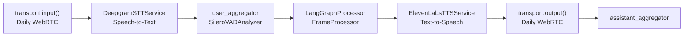
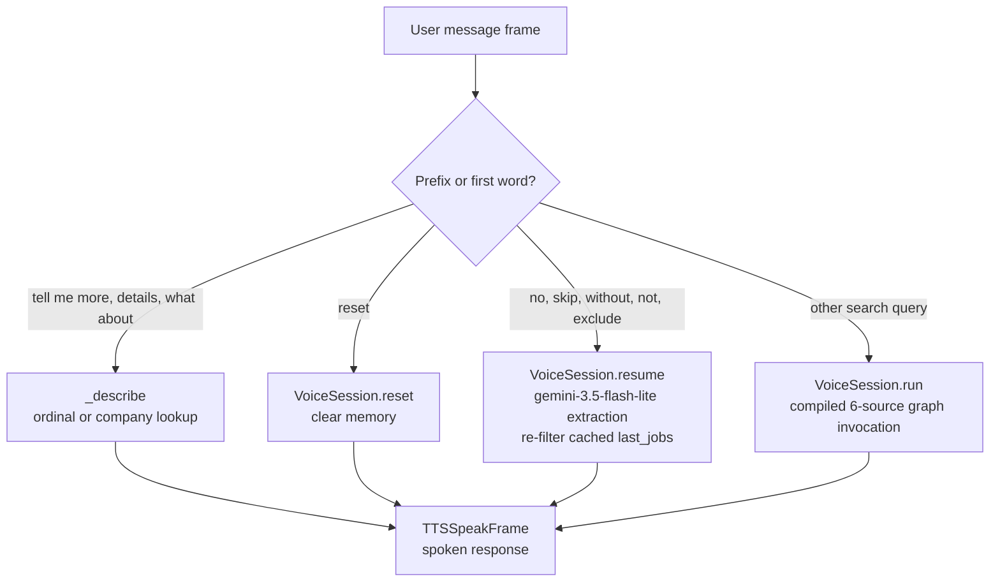

# Voice Agent Architecture

A real-time voice interface that allows users to interact conversationally with the same LangGraph job search agent powering the [REST API](architecture/backend-api.md). Built with [Pipecat](https://pipecat.ai), the voice subsystem runs as a local demo server connecting browser audio to speech and language models through WebRTC.

`voice_agent.py` imports `graph`, `normalize_jobs`, and `filter_jobs` directly from `agent.py` and compiles the graph with an in-memory `MemorySaver` checkpointer. It runs the exact same six-source fan-out graph (RemoteOK via `fetch_jobs`, Himalayas via `fetch_sjobs`, Remotive via `fetch_tjobs`, Jobicy via `fetch_fjobs`, Workable via `fetch_wjobs`, and Getro VCs via `fetch_gjobs`) used across the REST and MCP entry points, rather than maintaining a separate agent implementation. See [Agent Graph](architecture/agent-graph.md) for full graph topology and [Integrations](integrations.md) for source details.

## Real-Time Audio Pipeline

The voice bot is structured around a Pipecat cascade pipeline: audio input via WebRTC, speech-to-text transcription, user aggregation with voice activity detection (VAD), frame processing through LangGraph, text-to-speech synthesis, and WebRTC audio output.



*The full Pipecat cascade pipeline in bot.py: Daily WebRTC input, Deepgram STT, Silero VAD aggregation, LangGraphProcessor, ElevenLabs TTS, and Daily WebRTC output.*

### Service Configuration

In `voice/server/bot.py`, pipeline services are instantiated and linked within `run_bot`:

- **WebRTC Transport (`DailyParams`)**: Configured with `audio_in_enabled=True` and `audio_out_enabled=True` to stream bidirectional audio with the client.
- **Speech-to-Text (`DeepgramSTTService`)**: Consumes incoming raw audio frames and produces transcripts using `DEEPGRAM_API_KEY`.
- **User Aggregator (`LLMContextAggregatorPair`)**: Couples the user context aggregator with `SileroVADAnalyzer` to detect speech boundaries and user turn completion.
- **Agent Processor (`LangGraphProcessor`)**: Custom frame processor acting as the LLM step in the pipeline, orchestrating `VoiceSession` actions.
- **Text-to-Speech (`ElevenLabsTTSService`)**: Synthesizes spoken output from `TTSSpeakFrame` text using `ELEVENLABS_API_KEY` and `ELEVENLABS_VOICE_ID` (which must be a Premade voice on standard tiers).
- **Assistant Aggregator**: Tracks assistant utterances within the shared `LLMContext`.

The pipeline is wrapped in a `PipelineWorker` with metrics enabled (`enable_metrics=True`, `enable_usage_metrics=True`). Transport event hooks handle connection lifecycle:
- `@transport.event_handler("on_client_connected")` logs connection initiation.
- `@transport.event_handler("on_client_disconnected")` immediately halts processing by awaiting `worker.cancel()`.

Execution is managed by `WorkerRunner(handle_sigint=False)` via `pipecat.runner.run.main()`.

## VoiceSession Lifecycle and State Management

Unlike the primary text agent which maintains conversation state across sessions in PostgreSQL via `PostgresSaver`, voice sessions are **stateless and short-lived**. `voice_agent.py` initializes a module-level `MemorySaver` checkpointer:

```python
checkpointer = MemorySaver()
compiled_agent = graph.compile(checkpointer=checkpointer)
```

At module import time, `voice_agent.py` also initializes a dedicated exclusion extraction chain:

```python
llm = init_chat_model(
    model="google_genai:gemini-3.5-flash-lite",
    api_key=os.getenv("GEMINI_API_KEY"),
    max_retries=10
)
chain = llm | StrOutputParser()
```

Each instantiated `VoiceSession` manages its own isolated state:
- `memory: list[str]` — accumulated comma-separated keyword exclusion strings extracted from feedback.
- `thread_id: str` — a fresh `uuid4` string generated per session, supplied in `{"configurable": {"thread_id": self.thread_id}}` so LangGraph scopes checkpointer state per call.
- `last_query: str` — placeholder for session query tracking.
- `last_jobs: list[dict]` — normalized job results cached from the most recent graph search run, reused during feedback filtering and filter resets.

### Lifecycle Methods

| Method | Graph Invocation | Underlying Mechanism | Output |
|---|---|---|---|
| `run(user_input)` | Yes (6-source fan-out) | Invokes `compiled_agent.invoke({"user_input": user_input, "fetched_jobs": []}, config=config)`. Normalizes raw results with `normalize_jobs` and stores them in `self.last_jobs`. Evaluates `filter_jobs(self.last_jobs, self.memory)`. | `{"type": "jobs", "data": [...]}` |
| `resume(feedback)` | No (local cache re-filter) | Executes `chain.invoke(extraction_prompt)` with `gemini-3.5-flash-lite` to extract avoidance keywords. Appends keywords to `self.memory`. Re-evaluates `filter_jobs(self.last_jobs, self.memory)` over existing `last_jobs`. | `{"type": "jobs", "data": [...]}` |
| `reset()` | No (local cache re-filter) | Clears `self.memory` to `[]`. Re-evaluates `filter_jobs(self.last_jobs, self.memory)` against the empty exclusion list. | `{"type": "jobs", "data": [...]}` |

### Voice vs. Text Agent Filtering

In a voice session, a user typically explores one query per call while iteratively pruning results (e.g., "no PHP", "skip junior roles"). Rather than re-querying external job APIs or re-running the 6-source LangGraph fan-out, `VoiceSession` caches normalized search results in `last_jobs` and performs fast local filtering via `filter_jobs`. The text agent similarly avoids repeated external fetches during `/feedback`, but stores preferences durably in PostgreSQL; the voice agent retains exclusions only in memory for the duration of the WebRTC session.

## Command Routing and Frame Processing

`LangGraphProcessor` (in `voice/server/langgraph_processor.py`) bridges Pipecat pipeline frames with `VoiceSession`. It subclasses `FrameProcessor` and inspects incoming `LLMContextFrame` messages to route spoken user turns.



*Voice command routing in LangGraphProcessor: detail prefixes trigger spoken descriptions, reset clears exclusions, feedback triggers extraction and re-filtering, and other queries invoke the 6-source graph.*

### Frame Invariants and Offloading

1. **Non-LLM Frame Passthrough**: Any frame that is not an `LLMContextFrame` is pushed downstream immediately via `await self.push_frame(frame, direction)`.
2. **Deduplication Guard**: Pipecat context updates frequently send repeated frames. `_last_processed_message` tracks the last user utterance; duplicate identical inputs are discarded immediately.
3. **Async Event-Loop Protection**: Graph execution, external API requests, and Gemini keyword extraction are synchronous blocking calls. To prevent freezing audio frames, VAD analysis, and real-time interruption handling, all `VoiceSession` methods run inside worker threads via `await asyncio.to_thread(...)`.

### Routing Rules and Dispatches

The processor strips and lowercases the incoming message, dispatching actions according to prefix and first-word rules:

- **Detail Requests (`DETAIL_PREFIXES`)**: Triggers if the message begins with `"tell me more"`, `"more about"`, `"details"`, or `"what about"`. Calls `_describe(command)` and emits `TTSSpeakFrame`.
- **Filter Reset**: Triggers if the first token is `"reset"`. Awaits `asyncio.to_thread(self.session.reset)`.
- **Avoidance Feedback (`FEEDBACK_WORDS`)**: Triggers if the first token is in `{"no", "skip", "without", "not", "exclude"}`. Whole-word matching ensures phrases like `"notion developer"` continue to trigger fresh searches rather than exclusion feedback. Awaits `asyncio.to_thread(self.session.resume, last_user_message)`.
- **Search Query**: Any other command is treated as a job search query and awaits `asyncio.to_thread(self.session.run, last_user_message)`.

### Spoken Detail Lookup (`_describe`)

When a user inquires about a specific listing:
1. It parses ordinal words using `ORDINALS` (`"first"`, `"one"`, `"1"` → index 0; `"second"`, `"two"`, `"2"` → index 1; up to `"fifth"` → index 4).
2. If no ordinal is present, it falls back to substring matching against `company` or `position` fields in `self.shown_jobs`.
3. If no match is found, it prompts: `"I didn't catch which one. Try 'tell me more about the first one'."`
4. On match, it formats job title, company, location, salary, sanitized description, and notes the apply link index in the terminal.

### Sentence Cutting Hygiene (`_speakable`)

Raw job descriptions from aggregators often truncate mid-sentence or end with `...`. The helper function `_speakable`:
- Trims trailing `"..."`.
- Finds the last sentence terminator (`.`, `!`, `?`). If the index occurs beyond character 40, it truncates at that punctuation boundary.
- If no sentence boundary appears late enough, it strips the trailing dangling word and appends a period, preventing the TTS engine from vocalizing incomplete fragments.

### Dual Output Strategy

Voice interactions require concise audio combined with actionable links:
- **Terminal Display (`_print_jobs`)**: Spoken URLs are impractical. The processor prints full listing details, salaries, companies, and direct `apply_url` links directly to stdout.
- **Spoken Audio Summary (`TTSSpeakFrame`)**: If listings are returned, TTS speaks a concise summary: `"{N} jobs. Top two: {position} at {company}; {position} at {company}. The full list with links is on your screen. Ask me for details, or tell me what to skip."` If no jobs match, it speaks: `"Nothing matched. Say reset to clear your filters, or try another search."`

## File Organization and Dependencies

| File | Purpose |
|---|---|
| `voice_agent.py` | Defines `VoiceSession`, compiles `graph` from `agent.py` with `MemorySaver`, initializes `gemini-3.5-flash-lite` extraction chain, and implements `run`/`reset`/`resume`. |
| `voice/server/bot.py` | Sets up Pipecat pipeline components (Daily transport, Deepgram STT, ElevenLabs TTS, `LangGraphProcessor`), worker params, and event callbacks. |
| `voice/server/langgraph_processor.py` | `LangGraphProcessor` frame processor, command parsing, ordinal lookup, `_speakable` text cleanup, and terminal formatting. |
| `voice/server/pyproject.toml` | Server dependencies managed with `uv` (`pipecat-ai`, `langchain`, `langgraph`, `langchain-google-genai`). |
| `voice/README.md` | Operational instructions, environment setup, and developer notes. |

`voice_agent.py` lives at the project root alongside `agent.py`. `voice/server/langgraph_processor.py` adds `../../` to `sys.path` to import `VoiceSession` directly, ensuring zero graph duplication across the project.

## Configuration and Operations

### Environment Configuration

The voice subsystem requires the following environment variables configured in `.env`:

| Variable | Description |
|---|---|
| `DEEPGRAM_API_KEY` | Deepgram speech-to-text API credentials. |
| `ELEVENLABS_API_KEY` | ElevenLabs text-to-speech API credentials. |
| `ELEVENLABS_VOICE_ID` | Voice identifier (must use a Premade voice on standard ElevenLabs tier). |
| `GEMINI_API_KEY` | Google Gemini API key used by `voice_agent.py` for keyword extraction and `agent.py`. |
| `DAILY_API_KEY` | Daily.co WebRTC room and transport authentication key. |

### Running the Server

```bash
cd voice/server
uv sync
cp .env.example .env   # configure API keys
uv run bot.py
```

The server listens on `http://localhost:7860` and hosts the Pipecat Playground UI for browser testing.

### Operational Considerations

- **WSL2 Requirement for Windows**: `daily-python` does not provide native Windows binaries. Windows developers must execute the voice server within WSL2 (Ubuntu).
- **Filesystem Mount Overhead**: Importing LangChain across Windows mount points (`/mnt/c`) incurs significant I/O latency (~2 minutes initial import). Running directly within the ext4 Linux root filesystem reduces this overhead to approximately 1 second.
- **Session Isolation**: Sessions are completely ephemeral. Each browser connection instantiates a fresh `VoiceSession` with an empty `memory` exclusion list and unique `thread_id`. Memory does not survive disconnection.
