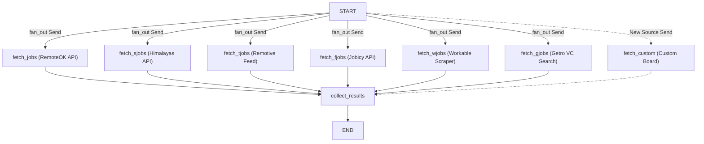
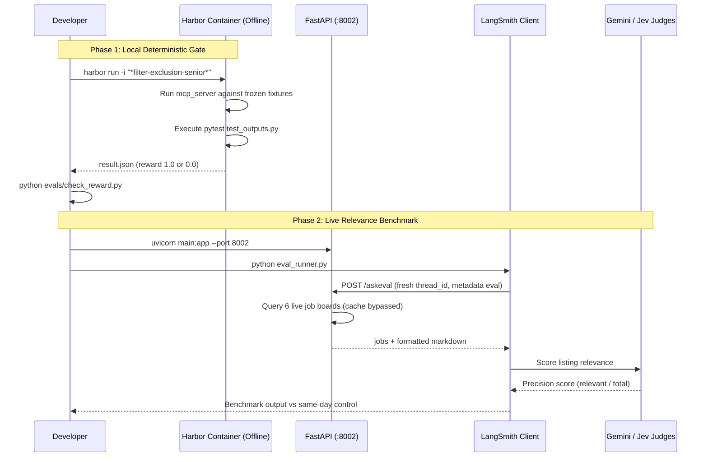
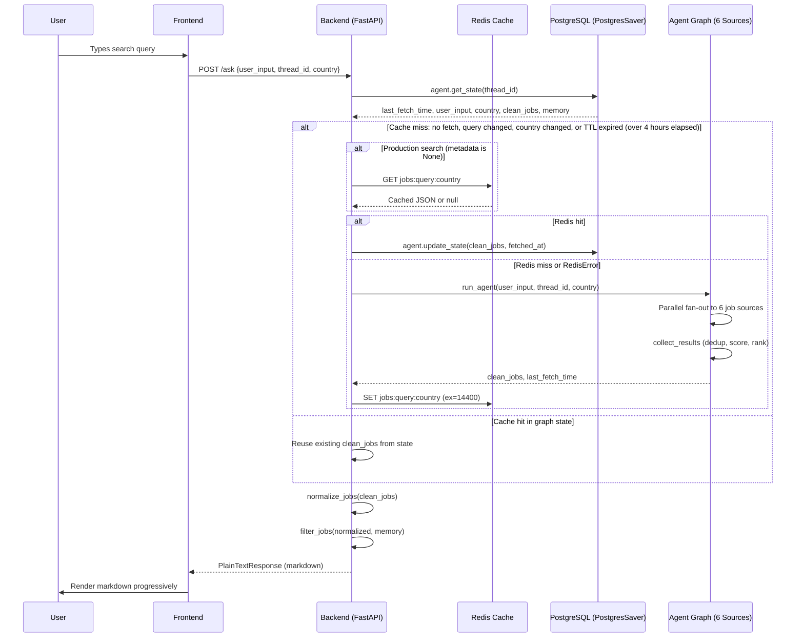
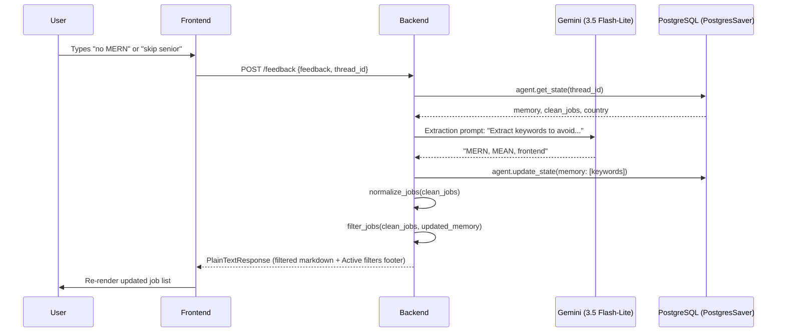

# Developer Workflows & Runbooks

This guide provides end-to-end developer workflows and operational runbooks for maintaining, extending, evaluating, and troubleshooting the job search system. It covers how to add external job board sources to the parallel fan-out graph, tune deterministic ranking and canonical matching rules, execute local and live evaluations, and diagnose runtime failures in Redis, Celery, and FastAPI.

---

## Developer Workflows Overview

| Workflow | Key Components | Primary Files | Verification Method |
|---|---|---|---|
| **[Adding or Modifying Job Sources](#1-adding-or-modifying-job-board-sources)** | LangGraph fan-out, ThreadPoolExecutor, query fallbacks, data normalization | `agent.py`, `evals/filter-exclusion-senior/environment/frozen_apis.py` | Local Harbor eval + live query test |
| **[Tuning Deterministic Ranking Rules](#2-tuning-deterministic-ranking-rules)** | Title weighting, canonical aliases, keyword bonuses, admission gates | `agent.py` (`score_job`, `collect_results`, `ALIASES`) | Harbor deterministic assertions + LangSmith eval |
| **[Running Harbor & LangSmith Evaluations](#3-evaluating-changes-harbor--langsmith)** | Docker offline eval container, LangSmith live benchmark, same-day controls | `eval_runner.py`, `evals/check_reward.py`, `main.py` (`/askeval`) | Harbor reward exit code + LangSmith precision |
| **[Debugging System Degradation & Failures](#4-debugging-system-degradation--runbooks)** | Redis outage fallback, Celery task failures, HTTP timeouts, health check | `main.py`, `tasks.py`, `helper.py` | Health endpoint, Redis CLI, Celery inspect |
| **[Runtime Request Flows](#5-runtime-request-flows)** | Keyword search, feedback memory loop, CV upload, n8n automated digest | `main.py`, `agent.py`, `tasks.py`, `helper.py` | Sequence validation across endpoints |

---

## 1. Adding or Modifying Job Board Sources

The search engine queries six external job sources in parallel during search execution. The LangGraph agent dispatches parallel requests from the `START` node via `fan_out()` into independent fetcher nodes, then aggregates the raw listings in `collect_results`.


*LangGraph parallel fan-out architecture for job board sources converging on collect_results.*

### Step-by-Step Guide to Adding a Source

#### Step 1: Implement the Fetcher Node Function
Add a new fetcher function in `agent.py` matching the signature `fetch_<name>(state: State) -> dict`:

```python
def fetch_custom(state: State) -> dict:
    if not state.get("user_input"):
        return {"fetched_jobs": []}
    signal = signal_tokens(state["user_input"])
    query = state["user_input"]
    country = state.get("country", "")
    
    try:
        # Implement network request with timeouts
        response = requests.get(
            f"https://api.example.com/jobs?q={urllib.parse.quote(query)}",
            headers={"User-Agent": "Mozilla/5.0"},
            timeout=30
        )
        if response.status_code != 200:
            return {"fetched_jobs": []}
        
        raw_jobs = response.json().get("data", [])
        # Pre-filter by title match against signal tokens
        fetched_jobs = [
            job for job in raw_jobs
            if any(title_hit(token, job_title(job)) for token in signal)
        ]
        return {"fetched_jobs": fetched_jobs}
    except requests.exceptions.RequestException as e:
        print(f"Error {e}", file=sys.stderr)
        return {"fetched_jobs": []}
```

#### Step 2: Configure Thread Pools for Multi-Tenant / Multi-Collection Sources
When a source partitions listings across multiple endpoints or collections—such as **Getro VC portfolio search**, which spans 9 distinct venture capital portfolios (`GETRO_VCS = [1680, 53552, 617, 222, 4350, 1518, 7715, 178, 29066]`)—use a `ThreadPoolExecutor` inside the fetcher node rather than blocking sequentially:

```python
def fetch_gjobs(state: State):
    if not state.get("user_input"):
        return {"fetched_jobs": []}
    signal = signal_tokens(state["user_input"])
    query = state["user_input"]
    raw = {}
    with ThreadPoolExecutor(max_workers=len(GETRO_VCS)) as pool:
        results = pool.map(lambda vc: vcsearch(vc, query), GETRO_VCS)
        for vc_jobs in results:
            for job in vc_jobs:
                raw.setdefault(job.get("url") or job.get("id"), job)
    fetched_jobs = [
        job for job in raw.values()
        if any(title_hit(token, job_title(job)) for token in signal)
    ]
    return {"fetched_jobs": fetched_jobs}
```

- **Thread pool sizing**: Set `max_workers` to match the collection count or a bounded pool (e.g., `max_workers=min(len(targets), 10)`).
- **Timeouts**: Enforce strict HTTP timeouts (e.g., `timeout=10` in `getrosearch`) to avoid stragglers stalling the graph.

#### Step 3: Implement Query and Geographic Fallbacks
Job board search APIs frequently fail on multi-word phrases or localized filters. Implement defensive fallback strategies modeled on existing fetchers:

1. **Tag-based query fallback (`distinctive_tokens`)**:
   - Extract distinctive tokens: `tags = distinctive_tokens(query)`.
   - In `vcsearch` (Getro), if the full query returns fewer than 10 listings (`len(jobs) < 10`), iterate over individual distinctive tags to augment results.
   - In RemoteOK (`fetch_jobs`) and Jobicy (`fetch_fjobs`), iterate through `tags` and stop once a page returns `ENOUGH = 50` listings.
2. **Geographical status fallback**:
   - In Jobicy (`fetch_fjobs`), if passing `geo=country` returns HTTP 400 (unrecognized country slug), re-request immediately without the `geo` parameter and allow `location_ok` in `collect_results` to handle filtering.
   - In Workable (`fetch_wjobs`), if the targeted country returns no search links, retry with `/search/worldwide/`.
3. **Untagged feed fallback**:
   - In Jobicy, if tagged searches return 0 listings, issue an untagged request to `https://jobicy.com/api/v2/remote-jobs`.
   - In Remotive (`remotive_feed`), cache the entire API feed in memory with a 6-hour TTL (`REMOTIVE_TTL = 6 * 3600`) since the upstream cache does not vary on query parameters.

#### Step 4: Ensure Listing Schema Compatibility
`collect_results` and `normalize_jobs` require listings to supply standard keys:

| Field | Accepted Source Keys | Fallback / Behavior |
|---|---|---|
| **Title** | `title`, `position`, `jobTitle` | Canonicalized with `job_title(job)` |
| **Employer** | `company`, `companyName`, `company_name` | Defaults to `"Unknown"` |
| **Location** | `location`, `jobGeo`, `candidate_required_location`, `locationRestrictions` | Evaluated against `REGIONS` and `GLOBAL_WORDS` |
| **Description** | `description`, `jobDescription`, `excerpt`, `jobExcerpt` | HTML tags stripped; truncated to 2,000 characters |
| **Salary** | `salary`, `salary_min` + `salary_max`, `minSalary` + `maxSalary` | Normalized to `"Salary not listed"` if missing |
| **Apply URL** | `apply_url`, `url`, `applicationLink` | Mandatory; jobs missing URLs are discarded |
| **Date / Age** | `date`, `pubDate`, `publication_date`, `datePosted`, `epoch` | Evaluated by `job_is_recent()` (`MAX_AGE_DAYS = 120`) |

#### Step 5: Wire the Node into LangGraph
In `agent.py`:
1. Register the node: `graph.add_node("fetch_custom", fetch_custom)`.
2. Add a `Send` entry in `fan_out()`:
   ```python
   def fan_out(state: State):
       return [
           Send("fetch_jobs", state),
           Send("fetch_sjobs", state),
           Send("fetch_tjobs", state),
           Send("fetch_fjobs", state),
           Send("fetch_wjobs", state),
           Send("fetch_gjobs", state),
           Send("fetch_custom", state),
       ]
   ```
3. Connect the node to result collection: `graph.add_edge("fetch_custom", "collect_results")`.

#### Step 6: Update Harbor Fixtures and Test
When a new source is added, update the deterministic offline evaluation:
1. Add mock HTTP routing in `evals/filter-exclusion-senior/environment/frozen_apis.py`:
   - For GET APIs, map hostname in `HOSTS = {"api.example.com": "custom.json"}`.
   - For POST APIs, extend `frozen_post` with custom payload handling.
2. Add captured fixture data in `evals/filter-exclusion-senior/environment/fixtures/`.
3. Execute the Harbor eval runbook to verify no existing exclusions are violated.

---

## 2. Tuning Deterministic Ranking Rules

Search relevance uses deterministic keyword scoring and canonical matching in `agent.py` without LLM calls. Candidate selection follows a strict two-phase gate: candidate admission gating and weighted relevance scoring.

<!-- openwiki: mermaid parse failed and this diagram was converted to a text fence so it does not break rendering. Fix the diagram source and restore the mermaid fence. Parser error: Heuristic: an unescaped angle bracket inside a label breaks rendering; rephrase the label. -->
```text
flowchart TD
    Raw["Raw Fetched Jobs from 6 Sources"] --> Dedup["Deduplicate by company + title hash"]
    Dedup --> Loc["Filter: location_ok(job, country)"]
    Loc --> Age["Filter: job_is_recent(job) (at most 120 days)"]
    Age --> Score["Compute score_job(job, query)"]
    Score --> Gate{"Candidate Admission Gate:<br/>Score at least TITLE_WEIGHT (10)<br/>AND (not wants_engineer OR title matches 'engineer')"}
    Gate -->|Pass| Sort["Sort by score descending"]
    Gate -->|Reject| Drop["Discard candidate"]
    Sort --> Cut["Slice top MAX_RESULTS (12)"]
    Cut --> Clean["Truncate description (2000 chars)<br/>Return clean_jobs"]
```
*Deterministic candidate filtering, scoring, admission gating, and ranking pipeline in collect_results.*

### The Relevance Scoring Formula (`score_job`)

Relevance scoring guarantees that a title match will always outrank non-title description matches:

$$\text{hits} = \min(\text{desc\_hits} + \text{gen\_hits} + \text{bonus}, 9) + (\text{title\_hits} \times \text{TITLE\_WEIGHT})$$

- **`TITLE_WEIGHT = 10`**: A single title match contributes 10 points.
- **`desc_hits`**: Number of distinct query signal tokens found in the canonicalized description.
- **`gen_hits`**: Number of generic terms from the query (`GENERIC`) present in the title (0 if query contains only generic terms).
- **`bonus = freq / 8`**: Total frequency count of all signal tokens occurring in the description, scaled by $1/8$.
- **Cap at 9**: Non-title components (`desc_hits + gen_hits + bonus`) are capped at $9$.
- **Architectural separation**: Because the non-title score cannot exceed 9, a listing with zero title hits can never score $\ge 10$, ensuring non-title hits never satisfy the admission threshold.

### Engineer / Developer Equivalency and Canonical Aliasing

Technical listings interchange "developer" and "engineer", while search queries often use short abbreviations (e.g., "ml", "llm"). `agent.py` handles this with `ALIASES` and `canon()`:

```python
ALIASES = {
    "large language models": "llm",
    "large language model": "llm",
    "natural language processing": "nlp",
    "artificial intelligence": "ai",
    "machine learning": "ml",
    "full-stack": "fullstack",
    "full stack": "fullstack",
    "back-end": "backend",
    "back end": "backend",
    "front-end": "frontend",
    "front end": "frontend",
    "postgresql": "postgres",
    "javascript": "js",
    "developer": "engineer"
}
```

#### How Equivalency Governs Candidate Admission
In `collect_results`:
```python
wants_engineer = title_hit("engineer", canon(query))
matched = [
    pair for pair in scored
    if pair[0] >= TITLE_WEIGHT and (not wants_engineer or title_hit("engineer", job_title(pair[1])))
]
```

1. When a user searches for `"python developer"`, `canon(query)` replaces `"developer"` with `"engineer"`, making `wants_engineer = True`.
2. `job_title(job)` runs `canon()` on listing titles. Postings titled `"Python Developer"` canonicalize to `"python engineer"`.
3. Postings titled `"Python Engineer"`, `"Software Engineer"`, or `"Python Developer"` all contain the token `"engineer"` and pass the gate.
4. Non-engineering roles (e.g., `"Python Instructor"` or `"Technical Writer"`) that happen to have high description matches fail the `title_hit("engineer", ...)` requirement and are excluded.

### Word Boundary Matching (`title_hit`)

Token matching uses regex word boundaries allowing standard technical suffixes:
```python
re.search(rf'\b{re.escape(token)}(?:js|s|\d+)?\b', title)
```
- **Allowed suffixes**: Plurals (`agents`), versions (`python3`), and JavaScript frameworks (`reactjs`).
- **Blocked prefixes**: Substring prefixes like `rust` in `anti-trust` or `java` in `javascript` are rejected by `\b`.

### Step-by-Step Tuning Workflow

1. **Adding New Aliases**: To support new synonyms (e.g., `sre` $\leftrightarrow$ `devops`), add them to `ALIASES` in `agent.py`. Ensure multi-word phrases precede single words to avoid partial replacement.
2. **Adjusting Bonus Scaling**: To increase the influence of keyword density in descriptions, modify the divisor in `bonus = freq / 8` (e.g., `freq / 5`). Keep in mind that non-title scores are still bounded by `min(..., 9)`.
3. **Modifying Seniority or Generic Vocabularies**:
   - `SENIORITY`: Add international seniority terms (e.g., Portuguese `"pleno"`, `"sênior"`) to `SENIORITY` in `agent.py`. Seniority terms in user memory exclude matching titles only, leaving descriptions unaffected.
   - `GENERIC`: Add terms that should not narrow searches on their own (e.g., `"consultant"`).
4. **Validation**: Always run Harbor evaluation to ensure Jobicy engineer fixtures remain admitted, followed by a LangSmith benchmark run.

---

## 3. Evaluating Changes (Harbor & LangSmith)

Testing job search quality requires two complementary evaluation systems: offline deterministic assertions in Harbor and live market relevance scoring in LangSmith.


*Two-tier evaluation workflow: offline deterministic CI gate followed by live LangSmith regression run.*

### Harbor Deterministic Evaluation (Local & CI Gate)

Harbor tests candidate admission, filter exclusions, and seniority gating against frozen fixtures without LLM calls or network access (`network_mode: none`).

#### Step-by-Step Local Execution

```bash
# 1. Ensure Harbor CLI is installed via uv
uv tool install harbor

# 2. Run the deterministic evaluation task inside Docker
PYTHONPATH=$(pwd) harbor run \
  -p evals \
  -i "*filter-exclusion-senior*" \
  -a evals.harbor_agents.pipeline_agent:PipelineAgent \
  -e docker \
  -o evals/jobs \
  --extra-docker-compose evals/configs/no-network.yaml \
  --job-name local -y

# 3. Verify trial reward and exit status
python evals/check_reward.py evals/jobs/local
```

#### Understanding Harbor Exit Codes (`check_reward.py`)
- **Exit 0 (Pass)**: Reward equals `1.0`. All 5 pytest assertions in `evals/filter-exclusion-senior/tests/test_outputs.py` passed against `expected.json` (6 kept, 6 dropped).
- **Exit 1 (Eval Failed)**: Reward is `0.0`. A regression occurred in `filter_jobs` or candidate admission. `check_reward.py` prints failed pytest assertions.
- **Exit 2 (Infra Error)**: Docker failed, task was cancelled, or `result.json` was missing.

For full test suite details and fixture design, see [Testing & Quality Assurance](testing.md) and [Harbor Evaluation](evals/harbor-eval.md).

---

### LangSmith Live Regression Evaluation

LangSmith evaluates end-to-end relevance across 24 realistic benchmark queries in dataset `job-search-eval` against live job boards.

#### Step-by-Step Live Run Procedure

1. **Start the Evaluation Backend**:
   Launch FastAPI on port 8002 with eval credentials configured:
   ```bash
   uvicorn main:app --port 8002
   ```
2. **Execute the Evaluation Harness**:
   In a separate terminal, execute `eval_runner.py`:
   ```bash
   python eval_runner.py
   ```
3. **Execution Semantics in `/askeval`**:
   - `eval_agent` uses `InMemorySaver()` instead of `PostgresSaver`, isolating eval state.
   - A fresh UUID `thread_id` is generated per test example.
   - `metadata = {"run_type": "eval"}` forces Redis job caching to be bypassed, ensuring every query tests live board responses.
4. **Judge Models and Scoring**:
   - **`gemini_listing_correctness`**: Uses `google_genai:gemini-3.5-flash-lite` with structured output `JobOutput(reason, relevant)`.
   - **`jev_correctness`**: Uses `typesafe/jev-1.13` via OpenRouter decision API with threshold `0.5`.
   - **`empty_ok` Short-Circuit**: If reference output marks empty results as acceptable and 0 listings return, scores `1.0` without calling LLMs.
5. **Same-Day Control Discipline**:
   Because external job boards change continuously, never compare a live run to a historical baseline from a previous week. Run a baseline control run on `main` on the same day, then run your branch to measure delta relevance.

For complete evaluation metrics and prompt structures, see [LangSmith Evaluation](evals/langsmith-eval.md).

---

## 4. Debugging System Degradation & Runbooks

This section outlines diagnostic and mitigation steps for three common operational failure modes: Redis degradation, Celery worker errors, and FastAPI timeout handling.

<!-- openwiki: mermaid parse failed and this diagram was converted to a text fence so it does not break rendering. Fix the diagram source and restore the mermaid fence. Parser error: Heuristic: an unescaped angle bracket inside a label breaks rendering; rephrase the label. -->
```text
flowchart TD
    Error["Runtime Exception / Alert"] --> Type{"Failure Domain"}

    Type -->|Redis Unavailable| R1["SlowAPI switches to in-memory limiter"]
    R1 --> R2["searchhelper catches RedisError<br/>cache treated as None"]
    R2 --> R3["run_agent executes live graph<br/>write failure caught safely"]
    R3 --> R4["/health resets last_ping on RedisError<br/>returns ok to prevent Render restarts"]

    Type -->|Celery Failure| C1["Check GET /jobs/{job_id} status"]
    C1 --> C2{"Is httpx.TimeoutException?"}
    C2 -->|Yes| C3["Return 'CV reader is slow' user error"]
    C2 -->|No| C4["Return generic failed status"]
    C4 --> C5["Inspect Celery ping on /health<br/>Restart solo worker if over 90s"]

    Type -->|FastAPI Timeout| T1["Check external HTTP requests (30s)"]
    T1 --> T2["Check Gemini LLM call timeout (10s)"]
    T2 --> T3["Verify blocking calls use asyncio.to_thread"]
```
*Operational failure diagnosis and graceful degradation paths for Redis, Celery, and FastAPI.*

---

### Runbook: Redis Outages & Degradation

Redis serves four functions: SlowAPI rate limiting, the 4-hour job search cache, Celery brokering/results, and daily Gemini quota counters.

#### Degradation Behavior Built into Code
1. **Rate Limiting**: `limiter = Limiter(..., in_memory_fallback_enabled=True)`. If Redis drops, rate limits fall back to in-memory tracking without throwing 500 errors.
2. **Job Cache Read/Write Guard**: In `searchhelper()` (`main.py`):
   ```python
   try:
       cache = r.get(savedjobs)
   except redis.exceptions.RedisError as e:
       logging.warning(e)
       cache = None
   ```
   If Redis fails, `cache` is treated as `None`, and the request falls back seamlessly to executing `run_agent()`. Writing to Redis on cache miss is similarly wrapped in `try...except redis.exceptions.RedisError`.
3. **Health Check Resiliency**: In `checkhealth()` (`GET /health`), exceptions from `r.ping()` are caught, logged with `logging.warning(e)`, and reset `last_ping = time.monotonic()`. Redis outages do not trigger container restarts on Render.

#### Diagnostic Steps
```bash
# 1. Test Redis connectivity directly
redis-cli -u $REDIS_URL ping

# 2. Check Redis memory usage and connected clients
redis-cli -u $REDIS_URL info memory
redis-cli -u $REDIS_URL info clients

# 3. Inspect application logs for warning traces
# Look for: "redis.exceptions.ConnectionError" or "redis.exceptions.TimeoutError"
```

#### Remediation Actions
1. **Restart Redis**: In Docker development: `docker restart jobsearch-redis`. In managed cloud: verify provider network access and connection limits.
2. **Clear Corrupted Cache Keys**: If specific queries hang or fail deserialization:
   ```bash
   redis-cli -u $REDIS_URL --scan --pattern "jobs:*" | xargs redis-cli -u $REDIS_URL del
   ```
3. **Quota Reset**: Daily Gemini budget keys follow `gemini_calls:<name>:<YYYY-MM-DD>`. If quota counters need manual clearing:
   ```bash
   redis-cli -u $REDIS_URL del gemini_calls:site:$(date +%Y-%-m-%-d)
   ```

---

### Runbook: Celery Worker Errors

The Celery worker processes asynchronous resume ingestion (`filework` in `tasks.py`), extracting CV text with `pdfplumber`, calling Gemini for keyword extraction, and querying LangGraph.

#### Degradation & Polling Semantics
When a client polls `GET /jobs/{job_id}`:
- **`res.status == "SUCCESS"`**: Returns `{"status": "done", "result": res.result}`.
- **`res.status == "FAILURE"`**: Logs exception via `logging.warning(res.result)`.
  - If `isinstance(res.result, httpx.TimeoutException)`: Returns `{"status": "failed", "detail": "The CV reader is slow right now, please try again in a minute"}`.
  - All other errors: Returns generic failure detail.
- **`res.status == "PENDING"`**: Returns `{"status": "pending"}`.

#### Worker Health Monitoring (`/health`)
`GET /health` sends a control ping to the worker:
```python
ping = celery_app.control.ping(destination=[f"celery@{socket.gethostname()}"], timeout=1.0)
```
- If the control ping returns an empty list, the endpoint checks elapsed time: `(time.monotonic() - last_ping) > 90`.
- If the worker remains unresponsive for greater than `PING_TIME = 90` seconds, the health check raises HTTP 503 (`Timed Out`), triggering platform container restart.

#### Diagnostic Steps
```bash
# 1. Check if the Celery worker process is alive
ps aux | grep "celery -A tasks"

# 2. Inspect active workers and task status via Celery CLI
celery -A tasks inspect ping
celery -A tasks inspect active

# 3. Inspect logs for worker crashes or OOM events
# Common root cause: Running with default prefork pool on free-tier instances
```

#### Remediation Actions
1. **Verify Worker Pool Mode**: Ensure Celery is started with `--pool=solo`. The `solo` pool prevents fork-based connection pool corruption with `psycopg` and avoids out-of-memory errors on memory-constrained servers:
   ```bash
   celery -A tasks worker --pool=solo -l info
   ```
2. **Database Connection Pool**: Ensure `DATABASE_URL` connects to PostgreSQL via the **session pooler** (port `5432`), not the transaction pooler (port `6543`), as `PostgresSaver` uses prepared statements.
3. **Purge Backlog**: If stale tasks block the queue:
   ```bash
   celery -A tasks purge -f
   ```

---

### Runbook: FastAPI Timeout Handling & Latency

End-to-end search latency depends on six external job APIs and Gemini LLM calls. Timeouts must be bounded to protect ASGI worker capacity.

#### Upstream Timeout Limits in Code
- **External Job Boards**:
  - RemoteOK: `timeout=30`
  - Himalayas: `timeout=30`
  - Remotive: `timeout=30` (with 6h in-memory TTL)
  - Workable: `timeout=30`
  - Jobicy: `timeout=30`
  - Getro VC Search: `timeout=10`
- **Gemini LLM Invocations**: Configured in `helper.py` (`llmchain`) with `timeout=10` and `max_retries=2`.
- **CV Ingestion Endpoint (`/upload`)**: Declared as `async def`. To prevent CPU-bound PDF parsing and synchronous network calls from blocking FastAPI's async event loop, operations are offloaded to worker threads:
  ```python
  text = await asyncio.to_thread(pdfread, file)
  await asyncio.to_thread(check_gemini_budget, "site", SITE_LIMIT)
  job = await asyncio.to_thread(filework.delay, text, thread_id, country)
  ```

#### Diagnostic Steps
1. **Identify Stalled Requests**: Check Uvicorn access logs for request durations exceeding 10 seconds.
2. **Verify Event Loop Blocking**: Confirm no synchronous `requests.get()` calls or `pdfplumber` operations run directly inside `async def` route handlers.
3. **Trace API Calls in LangSmith**: Inspect external latency for each fan-out branch via LangSmith traces (`LANGSMITH_TRACING=true`).

For full operational deployment configuration, see [Operations & Runbook](operations.md).

---

## 5. Runtime Request Flows

### 1. Keyword Job Search Flow

The primary search endpoint (`POST /ask`) evaluates a four-condition state freshness check and queries the Redis job cache before running the agent graph.


*End-to-end keyword job search request flow showing four-condition cache evaluation and Redis degradation.*

- **Four-condition check in `searchhelper()`**: The agent graph re-executes only if:
  1. `not last_known_fetch` (no previous search in this thread),
  2. `current_query != input.user_input` (query text changed),
  3. `current_country != input.country` (selected country changed), or
  4. `(datetime.now() - datetime.fromisoformat(last_known_fetch)).total_seconds() > 14400` (greater than 4 hours elapsed).
- **Postgres checkpointer optimization**: `run_agent()` specifies `durability="exit"`, writing state checkpoints only when graph execution exits rather than after each fan-out step.

---

### 2. Feedback & Negative Memory Update Flow

User feedback (`POST /feedback`) updates exclusion memory without re-running the agent graph.


*Feedback workflow: Gemini extracts avoidance keywords, thread memory is persisted, and cached jobs are re-filtered locally.*

- **No Graph Re-run**: Cached jobs (`clean_jobs`) are re-filtered in-memory using `filter_jobs(clean_jobs, updated_memory)`.
- **Input Limit**: Feedback strings are capped at 100 characters (`Field(min_length=1, max_length=100)`).
- **Budget Tracking**: Calls `check_gemini_budget("site", 100)`.

---

### 3. CV Upload Search Flow

1. User uploads a PDF resume from the frontend.
2. `POST /upload` validates file type (`application/pdf`) and size (max 5MB).
3. `pdfread` extracts text from the first 5 pages (`pages[:5]`) via `pdfplumber` off-thread.
4. Gemini budget is validated (`check_gemini_budget("site", 100)`).
5. Celery task `filework.delay(text, thread_id, country)` is dispatched, returning `{"job_id": job.id}`.
6. The Celery worker invokes Gemini structured extraction (`CVKeywords`), compiles LangGraph with `PostgresSaver`, executes `run_agent()`, normalizes listings, filters by memory, and formats markdown.
7. The frontend polls `GET /jobs/{job_id}` until completion.

---

### 4. n8n Automated Digest Flow

The automated digest executes on a 12-hour schedule via n8n:
1. **Wake Ping**: Sends `GET /health` to wake sleeping Render free-tier instances, waiting 60s.
2. **Digest Fetch**: Calls `POST /digest` with header `x-api-key: $N8N_DEDUPE`.
3. **Database Deduplication**: The backend queries PostgreSQL `SELECT joblink FROM n8njobs`, excludes links already dispatched, and returns fresh listings with their URLs.
4. **Link Recording**: n8n calls `POST /digest/sent` to insert new links into `n8njobs` via `ON CONFLICT (joblink) DO NOTHING`.
5. **Personalized Evaluation**: n8n invokes `POST /evaluate` with header `x-api-key: $EVALUATE_TOKEN` to evaluate job fit against candidate profile using Gemini.
6. **Email Dispatch**: Sends formatted recommendations to Gmail.

For full workflow node definitions, see [n8n Automation](operations/n8n-automation.md).

---

## Developer Change Guidance Matrix

| If you modify... | Affected Files | Mandatory Verification | Operational Precautions |
|---|---|---|---|
| **Relevance scoring formula** | `agent.py` (`score_job`) | Harbor local eval + LangSmith live benchmark | Ensure non-title hit score never reaches `TITLE_WEIGHT = 10` |
| **Synonym or token aliases** | `agent.py` (`ALIASES`, `canon`) | Harbor local eval (`test_the_filter_saw_the_frozen_listings`) | Multi-word phrases must precede single-word substrings |
| **Exclusion filtering** | `agent.py` (`filter_jobs`, `SENIORITY`) | Harbor local eval (all 5 pytest assertions) | Confirm seniority filters apply strictly to titles |
| **Adding a job source** | `agent.py` (fetcher, `fan_out`, `collect_results`) | Harbor fixture stubbing + live test | Enforce request timeouts; implement tag/geo fallbacks |
| **CV upload processing** | `tasks.py` (`filework`), `main.py` (`/upload`) | Upload test PDF via UI or curl | Run Celery with `--pool=solo`; offload blocking calls to `to_thread` |
| **Redis cache / rate limiting** | `main.py` (`searchhelper`, `limiter`) | Test API with Redis stopped | Confirm guarded `try...except` prevents unhandled 500 errors |
| **Database checkpointing** | `main.py`, `helper.py` (`run_agent`) | Keyword search and feedback loop | Connect via PostgreSQL session pooler (port 5432) |
| **API response format** | `helper.py` (`format_jobs_markdown`) | Frontend UI check + n8n digest run | Verify Markdown link formatting and source attribution line |

---

## Source References

- **Core Search & Ranking**: `agent.py`
- **FastAPI Endpoints & Degradation**: `main.py`
- **Celery Background Tasks**: `tasks.py`
- **Helper Utilities & LLM Chains**: `helper.py`
- **Live Evaluation Harness**: `eval_runner.py`
- **Deterministic CI Evaluation**: `evals/filter-exclusion-senior/tests/test_outputs.py`, `evals/filter-exclusion-senior/environment/frozen_apis.py`, `evals/check_reward.py`
- **Deployment Specification**: `render.yaml`
- **Automation Flow**: `n8n_workflow.json`
