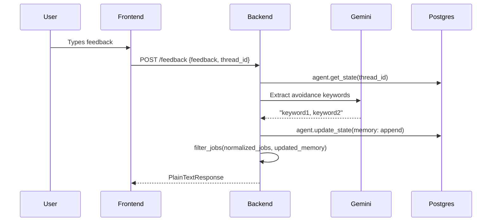

# Workflows

## 1. Keyword job search

<!-- openwiki: mermaid parse failed and this diagram was converted to a text fence so it does not break rendering. Fix the diagram source and restore the mermaid fence. Parser error: Heuristic: an unescaped angle bracket inside a label breaks rendering; rephrase the label. -->
```text
sequenceDiagram
    participant U as User
    participant F as Frontend
    participant B as Backend
    participant G as Agent Graph
    participant PG as Postgres
    participant R as Redis

    U->>F: Types keyword query
    F->>B: POST /ask {user_input, thread_id}
    B->>PG: agent.get_state(thread_id)
    PG-->>B: last_fetch_time, memory, clean_jobs, country
    alt Cache miss (no fetch, query changed, country changed, or > 4h)
        B->>G: agent.invoke({user_input})
        G->>G: fan_out to APIs, collect, dedup, score
        G-->>B: clean_jobs, last_fetch_time
        B->>R: Cache results (key: jobs:{query}:{country}, ex: 14400)
    else Cache hit
        B->>B: use cached results
    end
    B->>B: normalize_jobs(clean_jobs)
    B->>B: filter_jobs(normalized, memory)
    B-->>F: PlainTextResponse (markdown)
```

The search process uses a three-condition cache check (no previous fetch, query changed, country changed, or >4 hours elapsed) to decide whether to re-run the agent graph. Memory is applied post-graph via `filter_jobs` in `agent.py`.

## 2. Feedback / memory update



The feedback workflow updates thread memory without re-invoking the agent graph. It performs a local re-filtering of previously fetched cached jobs.

## 3. CV upload search

1.  User uploads a PDF (max 5MB).
2.  Text is extracted from the first 5 pages (`pdfplumber`).
3.  Gemini compresses the content into a keyword summary (max 20 words).
4.  This summary is used as the `user_input` for a standard keyword search.
5.  Results are filtered by thread memory and returned as markdown.

## 4. Harbor CI evaluation

The Harbor CI evaluation runs against the `/askeval` endpoint, which invokes an agent initialized with an `InMemorySaver`. This verifies the agent's filtering logic in isolation from the persistent database and external network state.

→ See [Agent Graph](architecture/agent-graph.md) for scoring logic.
